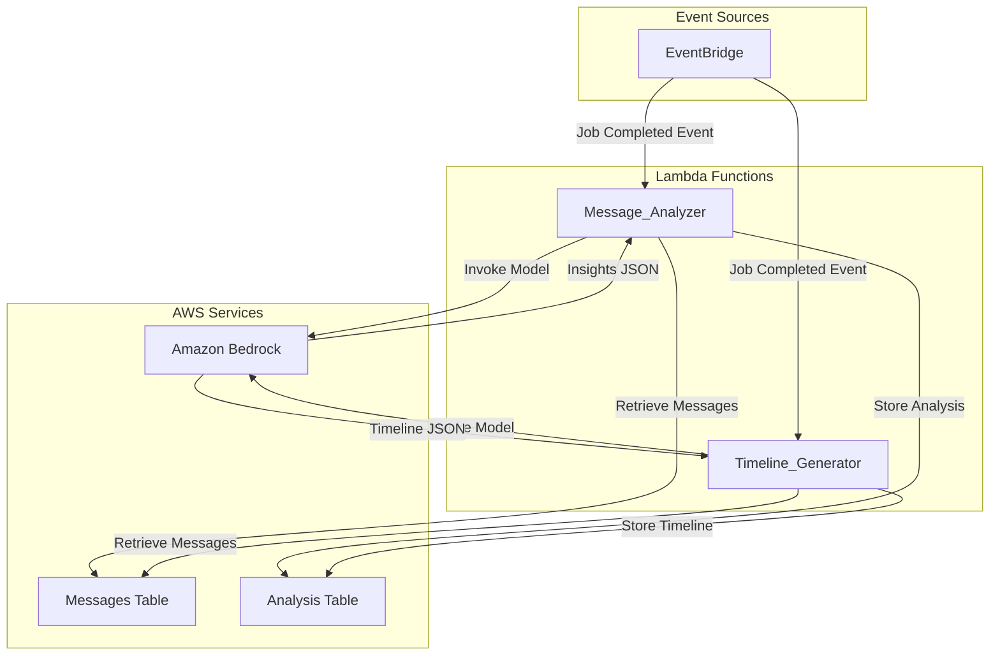

# Design Document: Bedrock Message Analysis

## Overview

The Bedrock Message Analysis feature implements the second segment of the FlowRecall message processing pipeline. After messages are ingested and stored in DynamoDB, this feature uses Amazon Bedrock's foundation models to analyze message content and extract actionable insights. The system identifies decisions, risks/blockers, tasks, and deadlines while filtering out noise like casual chatter and greetings. It also constructs a chronological timeline of project-related events.

The feature consists of two primary Lambda functions:
- **Message_Analyzer**: Retrieves messages from storage, invokes Bedrock for insight extraction, and stores structured results in DynamoDB
- **Timeline_Generator**: Constructs chronological event timelines from messages using Bedrock

Both functions leverage a shared Bedrock client abstraction that handles authentication, model invocation, response parsing, and error handling. Results are persisted in a dedicated Analysis table in DynamoDB with references to the original message IDs.

### Key Design Principles

1. **Event-Driven Architecture**: Lambda functions are triggered by EventBridge events when message ingestion completes
2. **Separation of Concerns**: Bedrock client logic is isolated from business logic for testability and reusability
3. **Structured Output**: All Bedrock responses follow strict JSON schemas validated through round-trip serialization
4. **Noise Filtering**: Prompt engineering explicitly excludes casual content, greetings, and signatures
5. **Error Resilience**: Comprehensive error handling for API failures, rate limits, timeouts, and invalid responses

## Architecture

### System Components



### Data Flow

1. **Trigger**: EventBridge emits a "Job Completed" event when message ingestion finishes
2. **Message Retrieval**: Lambda functions query the Messages table using jobId as partition key
3. **Bedrock Invocation**: Functions construct prompts with message content and invoke Bedrock
4. **Response Parsing**: JSON responses are parsed and validated against expected schemas
5. **Storage**: Structured analysis results are written to the Analysis table with message ID references
6. **Error Handling**: Failures at any stage are logged with context and appropriate error types

### EventBridge Integration

The feature integrates with EventBridge to trigger analysis when message ingestion completes:

```typescript
// Event pattern for triggering analysis
{
  "source": ["flow-recall.data-ingestion"],
  "detail-type": ["Job Completed"],
  "detail": {
    "jobId": [{ "exists": true }],
    "status": ["DONE"]
  }
}
```

Both Message_Analyzer and Timeline_Generator subscribe to this event pattern and process messages independently.

## Components and Interfaces

### 1. Message_Analyzer Lambda Function

**Purpose**: Extracts actionable insights (decisions, risks, tasks, deadlines) from stored messages using Bedrock.

**Handler Signature**:
```typescript
interface JobCompletedEvent {
  jobId: string;
  userId: string;
  messageCount: number;
  completedAt: string;
}

export async function handler(event: JobCompletedEvent): Promise<void>
```

**Processing Steps**:
1. Retrieve messages from Messages table using jobId
2. Construct insight extraction prompt with message content
3. Invoke Bedrock via BedrockClient
4. Parse and validate JSON response
5. Store analysis result in Analysis table
6. Emit CloudWatch metrics for monitoring

**Error Handling**:
- Message retrieval failures: Log error, emit metric, throw exception
- Bedrock invocation failures: Log error with failure reason, emit metric, throw exception
- JSON parsing failures: Log invalid response, emit metric, throw exception
- DynamoDB storage failures: Log error, emit metric, throw exception

### 2. Timeline_Generator Lambda Function

**Purpose**: Constructs chronological timelines of project-related events from stored messages using Bedrock.

**Handler Signature**:
```typescript
interface JobCompletedEvent {
  jobId: string;
  userId: string;
  messageCount: number;
  completedAt: string;
}

export async function handler(event: JobCompletedEvent): Promise<void>
```

**Processing Steps**:
1. Retrieve messages from Messages table using jobId
2. Sort messages chronologically by timestamp
3. Construct timeline generation prompt with sorted messages
4. Invoke Bedrock via BedrockClient
5. Parse and validate JSON response
6. Store timeline result in Analysis table
7. Emit CloudWatch metrics for monitoring

**Error Handling**:
- Same error handling patterns as Message_Analyzer
- Empty message sets return empty timeline arrays (not errors)

### 3. Bedrock Client

**Purpose**: Provides a reusable abstraction for Amazon Bedrock API interactions with error handling and response parsing.

**Interface**:
```typescript
interface BedrockClientConfig {
  modelId: string;
  region?: string;
  maxTokens?: number;
  temperature?: number;
}

interface BedrockInvokeParams {
  prompt: string;
  systemPrompt?: string;
}

interface BedrockResponse<T> {
  success: boolean;
  data?: T;
  error?: BedrockError;
}

interface BedrockError {
  type: 'AUTH' | 'RATE_LIMIT' | 'TIMEOUT' | 'INVALID_RESPONSE' | 'SYSTEM';
  message: string;
  details?: any;
}

class BedrockClient {
  constructor(config: BedrockClientConfig);
  
  async invoke<T>(params: BedrockInvokeParams): Promise<BedrockResponse<T>>;
}
```

**Implementation Details**:
- Uses AWS SDK v3 `@aws-sdk/client-bedrock-runtime`
- Authenticates via IAM role attached to Lambda execution role
- Supports Claude and Titan model families
- Implements exponential backoff for rate limit errors (not in initial version)
- Validates JSON responses before returning
- Logs all invocations with request/response metadata

**Model Selection**:
The initial implementation will use **Claude 3 Haiku** (`anthropic.claude-3-haiku-20240307-v1:0`) for cost-effectiveness and speed. The model ID is configurable via environment variable for easy switching.

### 4. Prompt Engineering

**Insight Extraction Prompt Structure**:
```
System Prompt:
You are an AI assistant that analyzes workplace communications to extract actionable insights. 
Focus only on explicit project-related information. Exclude casual chatter, greetings, 
signatures, and small talk. Return results in valid JSON format.

User Prompt:
Analyze the following messages and extract:
1. Decisions: Clear choices or conclusions made
2. Risks/Blockers: Issues, obstacles, or concerns raised
3. Tasks: Action items or work to be done (classify priority as high/medium/low)
4. Deadlines: Specific dates or timeframes mentioned

Messages:
[Message content with metadata]

Return JSON in this exact format:
{
  "decisions": [{"text": "...", "context": "...", "messageId": "..."}],
  "risks": [{"text": "...", "severity": "...", "messageId": "..."}],
  "tasks": [{"text": "...", "priority": "high|medium|low", "messageId": "..."}],
  "deadlines": [{"text": "...", "date": "...", "messageId": "..."}]
}
```

**Timeline Generation Prompt Structure**:
```
System Prompt:
You are an AI assistant that constructs chronological timelines from workplace communications.
Focus only on explicit project-related events. Exclude casual chatter, greetings, and 
signatures. Return results in valid JSON format.

User Prompt:
Analyze the following chronologically sorted messages and create a concise timeline of events.
Each entry should be a brief, factual statement about what happened.

Messages:
[Sorted message content with timestamps]

Return JSON in this exact format:
{
  "timeline": [
    {"timestamp": "ISO8601", "event": "...", "messageId": "..."}
  ]
}
```

**Prompt Design Considerations**:
- Explicit instructions to exclude noise (casual content, greetings, signatures)
- JSON schema provided in prompt for consistent output format
- Message metadata (sender, timestamp, source) included for context
- Priority classification guidance for tasks (high: urgent/blocking, medium: important, low: nice-to-have)
- Severity classification for risks (critical, high, medium, low)

## Data Models

### Messages Table (Existing)

The Messages table is created by the data-ingestion feature and stores normalized messages from Gmail and Slack.

**Schema**:
```typescript
interface MessageRecord {
  jobId: string;              // Partition key
  messageId: string;          // Sort key (UUID)
  timestamp: string;          // ISO 8601 format
  source: 'gmail' | 'slack';
  sender: string;
  subject?: string;           // Gmail only
  content: string;
  threadId?: string;
  channelId?: string;         // Slack only
  channelName?: string;       // Slack only
  deduplicationHash: string;
  metadata: Record<string, any>;
}
```

**Access Patterns**:
- Query all messages for a job: `Query(PK=jobId)`
- Query messages chronologically: `Query(PK=jobId, SK sorted by timestamp)` via JobIdTimestampIndex GSI

### Analysis Table (New)

The Analysis table stores structured analysis results from Bedrock with references to source messages.

**Schema**:
```typescript
interface AnalysisRecord {
  analysisId: string;         // Partition key (UUID)
  jobId: string;              // GSI partition key
  userId: string;             // GSI partition key
  analysisType: 'insights' | 'timeline';
  createdAt: string;          // ISO 8601 format, GSI sort key
  messageIds: string[];       // List of analyzed message IDs
  
  // Insights fields (when analysisType = 'insights')
  decisions?: Decision[];
  risks?: Risk[];
  tasks?: Task[];
  deadlines?: Deadline[];
  
  // Timeline fields (when analysisType = 'timeline')
  timeline?: TimelineEntry[];
}

interface Decision {
  text: string;
  context: string;
  messageId: string;
}

interface Risk {
  text: string;
  severity: 'critical' | 'high' | 'medium' | 'low';
  messageId: string;
}

interface Task {
  text: string;
  priority: 'high' | 'medium' | 'low';
  messageId: string;
}

interface Deadline {
  text: string;
  date: string;              // ISO 8601 format
  messageId: string;
}

interface TimelineEntry {
  timestamp: string;          // ISO 8601 format
  event: string;
  messageId: string;
}
```

**DynamoDB Table Configuration**:
```typescript
new dynamodb.Table(this, 'AnalysisTable', {
  tableName: 'bedrock-analysis',
  partitionKey: {
    name: 'analysisId',
    type: dynamodb.AttributeType.STRING,
  },
  billingMode: dynamodb.BillingMode.PAY_PER_REQUEST,
  pointInTimeRecovery: true,
  encryption: dynamodb.TableEncryption.AWS_MANAGED,
  removalPolicy: cdk.RemovalPolicy.DESTROY,
});
```

**Global Secondary Indexes**:

1. **JobIdCreatedAtIndex**: Query analyses by job
   - Partition key: `jobId`
   - Sort key: `createdAt`
   - Projection: ALL

2. **UserIdCreatedAtIndex**: Query analyses by user chronologically
   - Partition key: `userId`
   - Sort key: `createdAt`
   - Projection: ALL

**Access Patterns**:
- Get analysis by ID: `GetItem(PK=analysisId)`
- Query analyses for a job: `Query(JobIdCreatedAtIndex, PK=jobId)`
- Query user's analyses chronologically: `Query(UserIdCreatedAtIndex, PK=userId, SK sorted by createdAt)`

### Bedrock Request/Response Models

**Insight Extraction Response**:
```typescript
interface InsightExtractionResponse {
  decisions: Decision[];
  risks: Risk[];
  tasks: Task[];
  deadlines: Deadline[];
}
```

**Timeline Generation Response**:
```typescript
interface TimelineGenerationResponse {
  timeline: TimelineEntry[];
}
```

Both responses must be valid JSON that can be parsed by `JSON.parse()` and serialized back with `JSON.stringify()` to produce equivalent structured data (round-trip property).


## Correctness Properties

*A property is a characteristic or behavior that should hold true across all valid executions of a system—essentially, a formal statement about what the system should do. Properties serve as the bridge between human-readable specifications and machine-verifiable correctness guarantees.*

### Property 1: Analysis Result Structure Completeness

*For any* set of messages analyzed by Message_Analyzer, the returned Analysis_Result must contain all required arrays: decisions, risks, tasks, and deadlines, each properly structured with their respective fields.

**Validates: Requirements 1.1, 4.1, 4.2, 4.3, 4.4**

### Property 2: Task Priority Validity

*For any* task extracted by Message_Analyzer, the task's priority field must be exactly one of the valid enum values: "high", "medium", or "low".

**Validates: Requirements 1.2, 4.6**

### Property 3: Analysis Result JSON Round-Trip

*For any* analysis result produced by Message_Analyzer, parsing the JSON output with JSON.parse() and then serializing it back with JSON.stringify() must produce equivalent structured data.

**Validates: Requirements 1.7**

### Property 4: Timeline Result Structure Completeness

*For any* set of messages analyzed by Timeline_Generator, the returned result must contain a timeline array with properly structured timeline entry objects.

**Validates: Requirements 2.1, 4.5**

### Property 5: Timeline Entry Timestamp Presence

*For any* timeline entry in a Timeline_Generator result, the entry must include a valid timestamp field in ISO 8601 format.

**Validates: Requirements 4.7**

### Property 6: Timeline Result JSON Round-Trip

*For any* timeline result produced by Timeline_Generator, parsing the JSON output with JSON.parse() and then serializing it back with JSON.stringify() must produce equivalent structured data.

**Validates: Requirements 2.7**

### Property 7: Valid JSON Output

*For any* result produced by Message_Analyzer or Timeline_Generator, the output must be valid JSON that can be successfully parsed by JSON.parse() without throwing an error.

**Validates: Requirements 1.6, 2.6, 4.8**

### Property 8: Bedrock Response Parsing

*For any* valid Bedrock API response, the Bedrock_Client must successfully parse the response into the expected structured data format matching the response schema.

**Validates: Requirements 3.4**

### Property 9: Bedrock Error Handling

*For any* Bedrock invocation failure (network error, API error, authentication failure), the Bedrock_Client must return a BedrockResponse object with success=false and a BedrockError containing a descriptive error type and message.

**Validates: Requirements 3.5**

### Property 10: Invalid JSON Error Handling

*For any* Bedrock response containing invalid JSON, the Bedrock_Client must return a BedrockResponse with success=false and a BedrockError with type='INVALID_RESPONSE'.

**Validates: Requirements 3.6, 7.4**

### Property 11: Message Retrieval Field Completeness

*For any* message retrieved from the Message_Store, the message object must include all required fields: content, sender, timestamp, and metadata.

**Validates: Requirements 5.2**

### Property 12: Message Retrieval Error Handling

*For any* message retrieval failure from DynamoDB, the Message_Analyzer must return an error response indicating the retrieval failure with appropriate error type and message.

**Validates: Requirements 5.3, 7.3**

### Property 13: Analysis Record Unique Identifier

*For any* two analysis records stored in the Analysis_Table, their analysisId values must be unique (no collisions).

**Validates: Requirements 6.7**

### Property 14: Analysis Record Timestamp Presence

*For any* analysis record stored in the Analysis_Table, the record must include a createdAt field with a valid ISO 8601 timestamp.

**Validates: Requirements 6.8**

### Property 15: Analysis Record Message ID References

*For any* analysis record stored in the Analysis_Table, the record must include a messageIds array containing the IDs of all messages that were analyzed.

**Validates: Requirements 6.9**

### Property 16: DynamoDB Storage Error Handling

*For any* DynamoDB storage failure, the Message_Analyzer must return an error response indicating the storage failure with appropriate error type and message.

**Validates: Requirements 6.10**

### Property 17: Rate Limit Error Handling

*For any* Bedrock API rate limit error (429 response), the Bedrock_Client must return a BedrockResponse with success=false and a BedrockError with type='RATE_LIMIT'.

**Validates: Requirements 7.1**

### Property 18: Timeout Error Handling

*For any* Bedrock invocation that exceeds the timeout threshold, the Bedrock_Client must return a BedrockResponse with success=false and a BedrockError with type='TIMEOUT'.

**Validates: Requirements 7.2**

### Property 19: Error Response Structure

*For any* error that occurs during Message_Analyzer execution, the error response must include both an error type (AUTH, RATE_LIMIT, TIMEOUT, INVALID_RESPONSE, SYSTEM) and a descriptive error message.

**Validates: Requirements 7.5**

## Error Handling

The feature implements comprehensive error handling across all components to ensure resilience and debuggability.

### Error Types

The system defines five error types for classification:

1. **AUTH**: Authentication or authorization failures with AWS Bedrock
2. **RATE_LIMIT**: Bedrock API rate limit exceeded (429 responses)
3. **TIMEOUT**: Bedrock invocation exceeded timeout threshold
4. **INVALID_RESPONSE**: Bedrock returned malformed or unparseable JSON
5. **SYSTEM**: Unexpected errors (DynamoDB failures, network issues, etc.)

### Error Handling Patterns

**Bedrock Client Errors**:
```typescript
try {
  const response = await bedrockClient.invoke<InsightExtractionResponse>({
    prompt: constructPrompt(messages),
    systemPrompt: SYSTEM_PROMPT,
  });
  
  if (!response.success) {
    // Log error with context
    console.error('Bedrock invocation failed', {
      errorType: response.error?.type,
      errorMessage: response.error?.message,
      jobId,
    });
    
    // Emit CloudWatch metric
    await emitMetric('BedrockInvocationFailed', 1, {
      UserId: userId,
      ErrorType: response.error?.type || 'UNKNOWN',
    });
    
    throw new Error(`Bedrock invocation failed: ${response.error?.message}`);
  }
  
  return response.data;
} catch (error) {
  // Handle unexpected errors
  console.error('Unexpected error during Bedrock invocation', {
    error: (error as Error).message,
    jobId,
  });
  throw error;
}
```

**Message Retrieval Errors**:
```typescript
try {
  const messages = await retrieveMessages(jobId);
  
  if (messages.length === 0) {
    // Empty result is not an error - return empty analysis
    return {
      decisions: [],
      risks: [],
      tasks: [],
      deadlines: [],
    };
  }
  
  return messages;
} catch (error) {
  console.error('Message retrieval failed', {
    jobId,
    error: (error as Error).message,
  });
  
  await emitMetric('MessageRetrievalFailed', 1, {
    UserId: userId,
    ErrorType: 'SYSTEM',
  });
  
  throw new Error(`Failed to retrieve messages: ${(error as Error).message}`);
}
```

**DynamoDB Storage Errors**:
```typescript
try {
  await storeAnalysisResult(analysisRecord);
  
  console.log('Analysis result stored successfully', {
    analysisId: analysisRecord.analysisId,
    jobId: analysisRecord.jobId,
  });
} catch (error) {
  console.error('Failed to store analysis result', {
    analysisId: analysisRecord.analysisId,
    jobId: analysisRecord.jobId,
    error: (error as Error).message,
  });
  
  await emitMetric('AnalysisStorageFailed', 1, {
    UserId: userId,
    ErrorType: 'SYSTEM',
  });
  
  throw new Error(`Failed to store analysis: ${(error as Error).message}`);
}
```

### Retry Strategy

The initial implementation does not include automatic retries. Retries will be handled by:
- **EventBridge**: Can be configured with retry policies for Lambda invocations
- **Step Functions**: Future orchestration layer can implement sophisticated retry logic with exponential backoff

For rate limit errors specifically, the system logs the error and relies on EventBridge retry configuration to handle backoff.

### Logging Strategy

All errors are logged with structured JSON for CloudWatch Logs Insights queries:

```typescript
interface ErrorLog {
  timestamp: string;
  level: 'ERROR' | 'WARN';
  component: 'Message_Analyzer' | 'Timeline_Generator' | 'Bedrock_Client';
  errorType: 'AUTH' | 'RATE_LIMIT' | 'TIMEOUT' | 'INVALID_RESPONSE' | 'SYSTEM';
  errorMessage: string;
  jobId?: string;
  userId?: string;
  analysisId?: string;
  details?: any;
}
```

Example CloudWatch Logs Insights query:
```
fields @timestamp, component, errorType, errorMessage, jobId, userId
| filter level = "ERROR"
| sort @timestamp desc
| limit 100
```

### Monitoring and Alerting

CloudWatch metrics are emitted for all error scenarios:

- `BedrockInvocationFailed` - Dimensions: UserId, ErrorType
- `MessageRetrievalFailed` - Dimensions: UserId, ErrorType
- `AnalysisStorageFailed` - Dimensions: UserId, ErrorType
- `JSONParsingFailed` - Dimensions: UserId

Recommended CloudWatch alarms:
- Alert when `BedrockInvocationFailed` with ErrorType=RATE_LIMIT exceeds threshold
- Alert when `BedrockInvocationFailed` with ErrorType=AUTH occurs (indicates IAM issue)
- Alert when any error metric exceeds 10% of total invocations

## Testing Strategy

The feature requires both unit testing and property-based testing to ensure correctness and resilience.

### Unit Testing Approach

Unit tests focus on specific examples, integration points, and edge cases:

**Message_Analyzer Unit Tests**:
- Test with empty message set (edge case - should return empty arrays)
- Test with single message containing one decision
- Test with multiple messages containing mixed insights
- Test DynamoDB storage integration with mocked AWS SDK
- Test EventBridge event parsing
- Test CloudWatch metrics emission

**Timeline_Generator Unit Tests**:
- Test with empty message set (edge case - should return empty timeline)
- Test with single message
- Test with messages in chronological order
- Test with messages in reverse chronological order (should sort correctly)
- Test DynamoDB storage integration

**Bedrock_Client Unit Tests**:
- Test successful invocation with mocked Bedrock API
- Test authentication failure (401 response)
- Test rate limit error (429 response)
- Test timeout scenario
- Test invalid JSON response
- Test network error handling

**Prompt Construction Unit Tests**:
- Test prompt construction with various message formats
- Test system prompt inclusion
- Test message metadata formatting

### Property-Based Testing Approach

Property tests verify universal properties across randomized inputs using a property-based testing library. For TypeScript/Node.js, we'll use **fast-check**.

**Configuration**:
- Minimum 100 iterations per property test
- Each test tagged with feature name and property number
- Generators for messages, analysis results, and error scenarios

**Property Test Examples**:

```typescript
import fc from 'fast-check';

// Property 1: Analysis Result Structure Completeness
// Feature: bedrock-message-analysis, Property 1
describe('Property 1: Analysis Result Structure Completeness', () => {
  it('should return complete structure for any message set', async () => {
    await fc.assert(
      fc.asyncProperty(
        fc.array(messageGenerator()),
        async (messages) => {
          const result = await analyzeMessages(messages);
          
          expect(result).toHaveProperty('decisions');
          expect(result).toHaveProperty('risks');
          expect(result).toHaveProperty('tasks');
          expect(result).toHaveProperty('deadlines');
          expect(Array.isArray(result.decisions)).toBe(true);
          expect(Array.isArray(result.risks)).toBe(true);
          expect(Array.isArray(result.tasks)).toBe(true);
          expect(Array.isArray(result.deadlines)).toBe(true);
        }
      ),
      { numRuns: 100 }
    );
  });
});

// Property 2: Task Priority Validity
// Feature: bedrock-message-analysis, Property 2
describe('Property 2: Task Priority Validity', () => {
  it('should have valid priority for all tasks', async () => {
    await fc.assert(
      fc.asyncProperty(
        fc.array(messageGenerator()),
        async (messages) => {
          const result = await analyzeMessages(messages);
          const validPriorities = ['high', 'medium', 'low'];
          
          for (const task of result.tasks) {
            expect(validPriorities).toContain(task.priority);
          }
        }
      ),
      { numRuns: 100 }
    );
  });
});

// Property 3: Analysis Result JSON Round-Trip
// Feature: bedrock-message-analysis, Property 3
describe('Property 3: Analysis Result JSON Round-Trip', () => {
  it('should preserve structure through JSON round-trip', async () => {
    await fc.assert(
      fc.asyncProperty(
        fc.array(messageGenerator()),
        async (messages) => {
          const result = await analyzeMessages(messages);
          const serialized = JSON.stringify(result);
          const deserialized = JSON.parse(serialized);
          
          expect(deserialized).toEqual(result);
        }
      ),
      { numRuns: 100 }
    );
  });
});

// Property 7: Valid JSON Output
// Feature: bedrock-message-analysis, Property 7
describe('Property 7: Valid JSON Output', () => {
  it('should produce valid JSON for any message set', async () => {
    await fc.assert(
      fc.asyncProperty(
        fc.array(messageGenerator()),
        async (messages) => {
          const result = await analyzeMessages(messages);
          const serialized = JSON.stringify(result);
          
          // Should not throw
          expect(() => JSON.parse(serialized)).not.toThrow();
        }
      ),
      { numRuns: 100 }
    );
  });
});

// Property 9: Bedrock Error Handling
// Feature: bedrock-message-analysis, Property 9
describe('Property 9: Bedrock Error Handling', () => {
  it('should return error response for any invocation failure', async () => {
    await fc.assert(
      fc.asyncProperty(
        fc.oneof(
          fc.constant('NetworkError'),
          fc.constant('APIError'),
          fc.constant('AuthError')
        ),
        async (errorType) => {
          // Mock Bedrock to throw error
          mockBedrockError(errorType);
          
          const result = await bedrockClient.invoke({ prompt: 'test' });
          
          expect(result.success).toBe(false);
          expect(result.error).toBeDefined();
          expect(result.error?.type).toBeDefined();
          expect(result.error?.message).toBeDefined();
        }
      ),
      { numRuns: 100 }
    );
  });
});

// Property 13: Analysis Record Unique Identifier
// Feature: bedrock-message-analysis, Property 13
describe('Property 13: Analysis Record Unique Identifier', () => {
  it('should generate unique IDs for all analysis records', async () => {
    await fc.assert(
      fc.asyncProperty(
        fc.array(messageGenerator(), { minLength: 1, maxLength: 10 }),
        async (messageSets) => {
          const analysisIds = new Set<string>();
          
          for (const messages of messageSets) {
            const record = await createAnalysisRecord(messages);
            expect(analysisIds.has(record.analysisId)).toBe(false);
            analysisIds.add(record.analysisId);
          }
        }
      ),
      { numRuns: 100 }
    );
  });
});
```

**Custom Generators**:

```typescript
// Generator for normalized messages
function messageGenerator(): fc.Arbitrary<NormalizedMessage> {
  return fc.record({
    jobId: fc.uuid(),
    messageId: fc.uuid(),
    timestamp: fc.date().map(d => d.toISOString()),
    source: fc.constantFrom('gmail', 'slack'),
    sender: fc.emailAddress(),
    subject: fc.option(fc.string({ minLength: 5, maxLength: 100 })),
    content: fc.string({ minLength: 10, maxLength: 500 }),
    threadId: fc.option(fc.uuid()),
    channelId: fc.option(fc.uuid()),
    channelName: fc.option(fc.string({ minLength: 3, maxLength: 50 })),
    deduplicationHash: fc.hexaString({ minLength: 64, maxLength: 64 }),
    metadata: fc.dictionary(fc.string(), fc.anything()),
  });
}

// Generator for analysis results
function analysisResultGenerator(): fc.Arbitrary<InsightExtractionResponse> {
  return fc.record({
    decisions: fc.array(decisionGenerator()),
    risks: fc.array(riskGenerator()),
    tasks: fc.array(taskGenerator()),
    deadlines: fc.array(deadlineGenerator()),
  });
}

function taskGenerator(): fc.Arbitrary<Task> {
  return fc.record({
    text: fc.string({ minLength: 10, maxLength: 200 }),
    priority: fc.constantFrom('high', 'medium', 'low'),
    messageId: fc.uuid(),
  });
}
```

### Integration Testing

Integration tests verify end-to-end behavior with real AWS services (using LocalStack or test AWS account):

- Test Message_Analyzer with real DynamoDB tables
- Test Timeline_Generator with real DynamoDB tables
- Test EventBridge trigger integration
- Test IAM permissions for Bedrock access
- Test CloudWatch metrics and logs emission

### Testing Bedrock Integration

Since Bedrock is a managed AI service, testing requires special considerations:

**Mocking Strategy**:
- Unit tests mock Bedrock API responses using AWS SDK mocks
- Property tests use deterministic mock responses for consistency
- Integration tests can use real Bedrock API (with cost considerations)

**Prompt Testing**:
- Validate prompt construction logic with unit tests
- Test prompt variations with different message formats
- Manual testing with real Bedrock to verify output quality

**Cost Management**:
- Use smallest/cheapest model for integration tests (Claude 3 Haiku)
- Limit integration test runs to CI/CD pipeline only
- Consider using cached responses for frequent test scenarios

### Test Coverage Goals

- Unit test coverage: >80% for all Lambda functions and Bedrock client
- Property test coverage: All 19 correctness properties implemented
- Integration test coverage: All critical paths (happy path + major error scenarios)

### Continuous Integration

Tests run automatically on:
- Pull request creation
- Commits to main branch
- Scheduled nightly runs for integration tests

CI pipeline stages:
1. Lint and type check
2. Unit tests (fast, no AWS dependencies)
3. Property tests (fast, mocked dependencies)
4. Integration tests (slow, real AWS services in test account)

