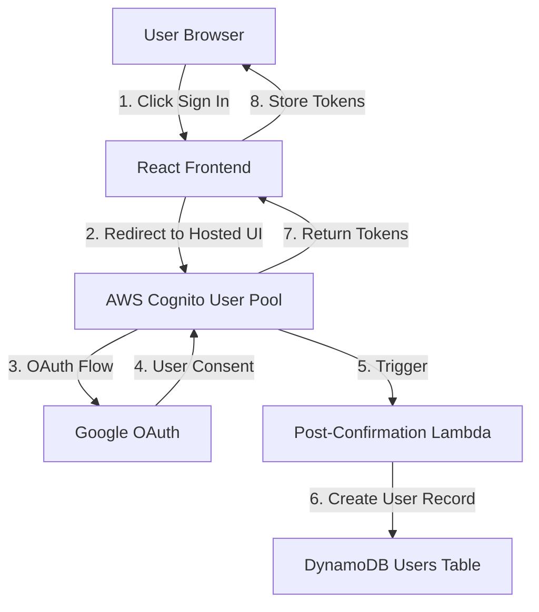

# Design Document: Cognito Google Authentication

## Overview

This design implements a complete authentication system for FlowRecall using AWS Cognito with Google OAuth integration. The architecture follows a clean separation of concerns with three distinct layers: authentication infrastructure (Cognito), data persistence (DynamoDB), and user interface (React). A Lambda trigger automatically provisions user records in DynamoDB upon successful signup, ensuring seamless onboarding.

The implementation uses AWS CDK to define infrastructure as code, with separate stacks for authentication and database resources. The frontend uses React with TypeScript and the AWS Amplify library for authentication flows, providing a modern OAuth experience through Cognito's hosted UI.

## Architecture

### High-Level Architecture



### Stack Architecture

The system is organized into three CDK stacks:

1. **DatabaseStack**: Defines the DynamoDB users table
2. **AuthStack**: Defines Cognito user pool, identity provider, and Lambda trigger
3. **BackendStack**: Existing stack (unchanged, for future features)

Stack dependencies flow from Auth → Database, with the Lambda trigger requiring write access to the users table.

### Component Interaction Flow

1. User clicks "Sign in with Google" in React frontend
2. Frontend redirects to Cognito Hosted UI
3. Cognito redirects to Google OAuth consent screen
4. User authorizes with Google
5. Google returns authorization code to Cognito
6. Cognito creates user in user pool
7. Cognito triggers Post-Confirmation Lambda
8. Lambda writes user record to DynamoDB
9. Cognito redirects back to frontend with tokens
10. Frontend stores tokens and displays authenticated UI

## Components and Interfaces

### 1. DatabaseStack (CDK)

**Purpose**: Defines DynamoDB table for user data storage

**Location**: `backend/lib/database-stack.ts`

**Resources**:
- DynamoDB Table: `users`
  - Partition Key: `internalUserId` (String)
  - Global Secondary Index: `cognitoUserIdIndex`
    - Partition Key: `cognitoUserId` (String)
  - Billing Mode: PAY_PER_REQUEST
  - Point-in-time recovery: Enabled
  - Encryption: AWS managed keys

**Exports**:
- `usersTableName`: Table name for cross-stack reference
- `usersTableArn`: Table ARN for IAM permissions

**Interface**:
```typescript
export class DatabaseStack extends cdk.Stack {
  public readonly usersTable: dynamodb.Table;
  
  constructor(scope: Construct, id: string, props?: cdk.StackProps) {
    // Creates users table with internalUserId as partition key
    // Creates GSI on cognitoUserId for lookups
    // Exports table name and ARN
  }
}
```

### 2. AuthStack (CDK)

**Purpose**: Defines Cognito user pool, Google OAuth provider, and post-confirmation trigger

**Location**: `backend/lib/auth-stack.ts`

**Dependencies**: DatabaseStack (requires table ARN for Lambda permissions)

**Resources**:
- Cognito User Pool
  - Username: Email
  - Auto-verify: Email
  - Sign-in aliases: Email
  - Standard attributes: Email (required)
  
- Cognito User Pool Client
  - OAuth flows: Authorization code grant
  - OAuth scopes: email, profile, openid
  - Callback URLs: Frontend URLs (localhost + production)
  - Logout URLs: Frontend URLs
  
- Cognito Identity Provider (Google)
  - Client ID: From environment variable or CDK context
  - Client secret: From AWS Systems Manager Parameter Store via Custom Resource
  - Attribute mapping: email → email
  - Note: Uses AwsCustomResource to fetch SecureString parameter at deploy time
  
- Lambda Function: Post-Confirmation Trigger
  - Runtime: Node.js 22.x
  - Handler: Creates user record in DynamoDB
  - Environment variables: USERS_TABLE_NAME
  - IAM permissions: dynamodb:PutItem on users table
  
- Cognito User Pool Domain
  - Prefix: flowrecall-auth (or configurable)

**Exports**:
- `userPoolId`: For frontend configuration
- `userPoolClientId`: For frontend configuration
- `userPoolDomain`: For constructing OAuth URLs

**Interface**:
```typescript
export interface AuthStackProps extends cdk.StackProps {
  usersTable: dynamodb.ITable;
}

export class AuthStack extends cdk.Stack {
  public readonly userPool: cognito.UserPool;
  public readonly userPoolClient: cognito.UserPoolClient;
  
  constructor(scope: Construct, id: string, props: AuthStackProps) {
    // Creates Cognito resources
    // Configures Google OAuth
    // Sets up Lambda trigger
    // Grants Lambda permissions to write to users table
  }
}
```

### 3. Post-Confirmation Lambda

**Purpose**: Automatically create user records in DynamoDB after successful signup

**Location**: `backend/lambda/post-confirmation/index.ts`

**Trigger**: Cognito Post-Confirmation event

**Input Event**:
```typescript
interface CognitoPostConfirmationEvent {
  request: {
    userAttributes: {
      sub: string;        // Cognito user ID
      email: string;      // User email
    };
  };
  response: {};
}
```

**Logic**:
1. Extract cognitoUserId (sub) and email from event
2. Generate unique internalUserId using UUID v4
3. Create timestamp for created and updated fields
4. Write record to DynamoDB with userRole = 'ORG_OWNER'
5. Return success response (or throw error on failure)

**Error Handling**:
- Log all errors to CloudWatch
- Throw errors to prevent user creation if DynamoDB write fails
- Include internalUserId, cognitoUserId, and email in error logs for debugging

**Interface**:
```typescript
import { v4 as uuidv4 } from 'uuid';

export async function handler(event: CognitoPostConfirmationEvent): Promise<CognitoPostConfirmationEvent> {
  const cognitoUserId = event.request.userAttributes.sub;
  const email = event.request.userAttributes.email;
  const internalUserId = uuidv4();
  const timestamp = new Date().toISOString();
  
  await dynamodb.putItem({
    TableName: process.env.USERS_TABLE_NAME,
    Item: {
      internalUserId: { S: internalUserId },
      cognitoUserId: { S: cognitoUserId },
      email: { S: email },
      userRole: { S: 'ORG_OWNER' },
      created: { S: timestamp },
      updated: { S: timestamp }
    }
  });
  
  return event;
}
```

### 4. Frontend Authentication Components

**Purpose**: Provide UI for login, signup, and authentication state management

**Location**: `frontend/src/`

**Components**:

#### Login.tsx
- Displays "Sign in with Google" button
- Redirects to Cognito Hosted UI on click
- Handles OAuth callback and token extraction
- Stores tokens in localStorage
- Redirects to main app on success

#### Signup.tsx
- Displays "Sign up with Google" button
- Redirects to Cognito Hosted UI with signup parameter
- Shares same OAuth flow as Login

#### AuthContext.tsx
- React Context for authentication state
- Provides: isAuthenticated, user, login, logout, loading
- Checks for valid tokens on mount
- Refreshes tokens when expired
- Clears tokens on logout

#### ProtectedRoute.tsx
- Wrapper component for authenticated routes
- Redirects to login if not authenticated
- Shows loading state while checking auth

**Authentication Flow**:
```typescript
// Login button click
const handleLogin = () => {
  const cognitoUrl = `https://${COGNITO_DOMAIN}/oauth2/authorize`;
  const params = new URLSearchParams({
    client_id: USER_POOL_CLIENT_ID,
    response_type: 'code',
    scope: 'email openid profile',
    redirect_uri: REDIRECT_URI
  });
  window.location.href = `${cognitoUrl}?${params}`;
};

// OAuth callback handling
useEffect(() => {
  const code = new URLSearchParams(window.location.search).get('code');
  if (code) {
    exchangeCodeForTokens(code);
  }
}, []);
```

### 5. Frontend Configuration

**Purpose**: Store Cognito configuration for frontend

**Location**: `frontend/src/config/auth.ts`

**Content**:
```typescript
export interface AuthConfig {
  userPoolId: string;
  userPoolClientId: string;
  cognitoDomain: string;
  redirectUri: string;
  logoutUri: string;
}

export const authConfig: AuthConfig = {
  userPoolId: 'REPLACE_WITH_USER_POOL_ID',
  userPoolClientId: 'REPLACE_WITH_CLIENT_ID',
  cognitoDomain: 'REPLACE_WITH_DOMAIN',
  redirectUri: window.location.origin + '/callback',
  logoutUri: window.location.origin + '/login'
};
```

**Note**: These values should be replaced during deployment or loaded from environment variables.

## Data Models

### DynamoDB Users Table Schema

**Table Name**: `users`

**Primary Key**: `internalUserId` (String, Partition Key)

**Global Secondary Index**: `cognitoUserIdIndex`
- Partition Key: `cognitoUserId` (String)
- Projection: ALL

**Attributes**:

| Attribute | Type | Description | Required | Default |
|-----------|------|-------------|----------|---------|
| internalUserId | String | FlowRecall's internal unique identifier (UUID v4) | Yes | Generated |
| cognitoUserId | String | Cognito user identifier (sub claim from JWT) | Yes | - |
| email | String | User email address from Google | Yes | - |
| userRole | String | User's role in the system | Yes | 'ORG_OWNER' |
| created | String | ISO 8601 timestamp of record creation | Yes | Current time |
| updated | String | ISO 8601 timestamp of last update | Yes | Current time |

**Example Record**:
```json
{
  "internalUserId": "550e8400-e29b-41d4-a716-446655440000",
  "cognitoUserId": "a1b2c3d4-e5f6-7890-abcd-ef1234567890",
  "email": "user@example.com",
  "userRole": "ORG_OWNER",
  "created": "2024-01-15T10:30:00.000Z",
  "updated": "2024-01-15T10:30:00.000Z"
}
```

**Access Patterns**:
1. Get user by internalUserId (primary key lookup)
2. Get user by cognitoUserId (GSI query on cognitoUserIdIndex)
3. Future: Query by email (requires additional GSI if needed)

### Cognito User Attributes

**Standard Attributes**:
- `sub`: Unique user identifier (maps to userId in DynamoDB)
- `email`: User email from Google
- `email_verified`: Always true for Google OAuth

**Custom Attributes**: None initially (can be added later)

### Authentication Tokens

**Stored in Frontend**:
- `idToken`: JWT containing user claims
- `accessToken`: For API authorization
- `refreshToken`: For obtaining new tokens

**Token Storage**: localStorage (key: `flowrecall_auth_tokens`)

**Token Structure**:
```json
{
  "idToken": "eyJhbGc...",
  "accessToken": "eyJhbGc...",
  "refreshToken": "eyJhbGc...",
  "expiresAt": 1705320600000
}
```

## Correctness Properties

*A property is a characteristic or behavior that should hold true across all valid executions of a system—essentially, a formal statement about what the system should do. Properties serve as the bridge between human-readable specifications and machine-verifiable correctness guarantees.*


### Property 1: User Record Creation Completeness

*For any* valid Cognito post-confirmation event with a cognitoUserId (sub) and email, when the Post-Confirmation Lambda executes, it should create a DynamoDB record containing a unique internalUserId (UUID v4 format), the cognitoUserId from the event, the email from the event, userRole set to "ORG_OWNER", and both created and updated timestamps as valid ISO 8601 strings approximately equal to the current time.

**Validates: Requirements 3.2, 3.3, 3.4, 3.5, 3.6, 3.7**

### Property 2: Lambda Error Handling

*For any* DynamoDB write failure in the Post-Confirmation Lambda, the Lambda should log the error details (including internalUserId, cognitoUserId, and email) and throw an exception to signal failure to Cognito.

**Validates: Requirements 3.8, 8.2, 8.3**

### Property 3: Authentication Redirect Parameters

*For any* click event on the authentication button in the frontend, the redirect URL should contain the correct Cognito domain, client_id, response_type=code, scope including email/openid/profile, and the configured redirect_uri.

**Validates: Requirements 4.3**

### Property 4: Logout Token Cleanup

*For any* authenticated session, when the logout function is called, all authentication tokens should be removed from localStorage and the authentication state should be set to unauthenticated.

**Validates: Requirements 5.5**

### Property 5: Success Audit Logging

*For any* successful user record creation in the Post-Confirmation Lambda, the Lambda should log an audit message containing the internalUserId, cognitoUserId, and email of the newly created user.

**Validates: Requirements 8.4**

## Error Handling

### Lambda Error Handling

**Post-Confirmation Lambda**:
- **DynamoDB Errors**: Catch all DynamoDB exceptions, log with full error details and user context, then re-throw to prevent user creation in Cognito
- **Missing Attributes**: Validate that event contains required attributes (sub, email) before processing
- **Logging**: Use structured logging with JSON format for CloudWatch Logs Insights queries
- **Timeout**: Set Lambda timeout to 10 seconds (DynamoDB writes should complete in <1s)

**Error Log Format**:
```json
{
  "level": "ERROR",
  "message": "Failed to create user record",
  "internalUserId": "550e8400-e29b-41d4-a716-446655440000",
  "cognitoUserId": "a1b2c3d4-e5f6-7890-abcd-ef1234567890",
  "email": "user@example.com",
  "error": "ConditionalCheckFailedException",
  "errorDetails": "..."
}
```

### Frontend Error Handling

**OAuth Callback Errors**:
- Check for `error` parameter in callback URL
- Display user-friendly messages for common errors:
  - `access_denied`: "You declined to sign in with Google"
  - `invalid_request`: "Authentication request was invalid. Please try again."
  - Default: "Authentication failed. Please try again."

**Token Exchange Errors**:
- Network failures: "Unable to connect. Please check your internet connection."
- Invalid code: "Authentication session expired. Please sign in again."
- Server errors: "Authentication service unavailable. Please try again later."

**Session Restoration Errors**:
- Invalid token format: Clear tokens and redirect to login
- Expired tokens: Attempt refresh, fallback to login redirect
- Network errors during refresh: Show offline indicator, retry on reconnection

**Error Display**:
- Use toast notifications for transient errors
- Use inline error messages for form-related errors
- Provide "Try Again" action for recoverable errors
- Log errors to console for debugging (not to external service initially)

### CDK Deployment Errors

**Missing Configuration**:
- Validate Google OAuth client ID and secret are provided
- Fail deployment with clear message if missing: "Google OAuth credentials not configured. Set GOOGLE_CLIENT_ID and configure secret in Parameter Store."

**Stack Dependencies**:
- Ensure DatabaseStack deploys before AuthStack
- Use explicit `addDependency()` in CDK to enforce order

**Resource Naming Conflicts**:
- Use unique prefixes for all resources
- Include environment name in resource names (dev, staging, prod)

## Testing Strategy

### Unit Testing

**Lambda Function Tests** (Jest):
- Test user record creation with valid event
- Test error handling with DynamoDB failures
- Test missing attribute validation
- Test timestamp generation
- Test logging output
- Mock DynamoDB client for isolated testing

**Frontend Component Tests** (React Testing Library with TypeScript):
- Test Login component renders "Sign in with Google" button
- Test Signup component renders "Sign up with Google" button
- Test AuthContext provides correct initial state
- Test logout function clears tokens
- Test error message display for various error types
- Test ProtectedRoute redirects when unauthenticated
- Mock window.location for redirect tests
- Verify TypeScript types are correctly enforced

**CDK Stack Tests** (Jest with CDK assertions):
- Test DatabaseStack creates users table with correct key schema
- Test AuthStack creates Cognito user pool with email username
- Test AuthStack configures Google identity provider
- Test Lambda has correct environment variables
- Test Lambda has IAM permissions to write to users table
- Test stack exports are defined correctly

### Property-Based Testing

**Property Test Configuration**:
- Library: fast-check (JavaScript/TypeScript property testing)
- Minimum iterations: 100 per property
- Tag format: `Feature: cognito-google-auth, Property {N}: {description}`

**Property Test 1: User Record Creation Completeness**
- Generate random Cognito events with valid sub and email
- Invoke Lambda handler with mocked DynamoDB
- Verify DynamoDB putItem called with correct structure
- Verify internalUserId is a valid UUID v4
- Verify cognitoUserId matches event.request.userAttributes.sub
- Verify email matches event.request.userAttributes.email
- Verify userRole is "ORG_OWNER"
- Verify created and updated are valid ISO timestamps
- Verify timestamps are within 1 second of current time
- **Tag**: `Feature: cognito-google-auth, Property 1: User record creation completeness`

**Property Test 2: Lambda Error Handling**
- Generate random Cognito events
- Mock DynamoDB to throw various errors
- Verify Lambda throws exception
- Verify error is logged with internalUserId, cognitoUserId, and email
- Verify log contains error details
- **Tag**: `Feature: cognito-google-auth, Property 2: Lambda error handling`

**Property Test 3: Authentication Redirect Parameters**
- Generate random button click events
- Invoke redirect handler
- Parse resulting URL
- Verify domain matches Cognito domain
- Verify client_id is present
- Verify response_type is "code"
- Verify scope contains "email", "openid", "profile"
- Verify redirect_uri matches configuration
- **Tag**: `Feature: cognito-google-auth, Property 3: Authentication redirect parameters`

**Property Test 4: Logout Token Cleanup**
- Generate random authentication states with tokens
- Set tokens in localStorage
- Call logout function
- Verify localStorage is empty for auth keys
- Verify authentication state is false
- **Tag**: `Feature: cognito-google-auth, Property 4: Logout token cleanup`

**Property Test 5: Success Audit Logging**
- Generate random Cognito events
- Mock DynamoDB to succeed
- Mock logger
- Invoke Lambda handler
- Verify logger called with success message
- Verify log contains internalUserId, cognitoUserId, and email
- **Tag**: `Feature: cognito-google-auth, Property 5: Success audit logging`

### Integration Testing

**End-to-End OAuth Flow** (Manual/Automated):
- Deploy to test environment
- Navigate to login page
- Click "Sign in with Google"
- Complete Google OAuth consent
- Verify redirect back to application
- Verify tokens stored in localStorage
- Verify user record created in DynamoDB
- Verify user can access protected routes

**Lambda Trigger Integration**:
- Create test user in Cognito via AWS CLI
- Verify Lambda trigger executes
- Verify user record appears in DynamoDB
- Verify CloudWatch logs contain success message

**Token Refresh Flow**:
- Authenticate user
- Wait for token expiration (or manually expire)
- Trigger protected route access
- Verify token refresh attempt
- Verify new tokens obtained or redirect to login

### Testing Best Practices

**Unit vs Property Tests**:
- Use unit tests for specific examples and edge cases (empty strings, null values, specific error codes)
- Use property tests for universal behaviors (all valid events create records, all errors are logged)
- Property tests provide broader coverage through randomization
- Unit tests provide concrete examples that document expected behavior

**Test Data Generation**:
- Use fast-check generators for random Cognito events
- Generate realistic email addresses and UUIDs
- Include edge cases in generators (very long emails, special characters)
- Ensure generated data matches AWS Cognito event structure

**Mocking Strategy**:
- Mock AWS SDK clients (DynamoDB, Cognito) in unit tests
- Use AWS CDK assertions for infrastructure tests
- Mock window.location and localStorage in frontend tests
- Avoid mocking internal application logic

**Test Organization**:
- Co-locate tests with source code
- Name test files with `.test.ts` or `.test.tsx` suffix
- Group related tests with `describe` blocks
- Use descriptive test names that explain the scenario

## Deployment Considerations

### Environment Configuration

**Required Environment Variables**:
- `GOOGLE_CLIENT_ID`: Google OAuth client ID (from Google Cloud Console)
- `GOOGLE_CLIENT_SECRET_PARAM`: Parameter name in AWS Systems Manager Parameter Store (default: `/flowrecall/google-oauth-client-secret`)
- `FRONTEND_URL`: Frontend application URL for callback configuration
- `ENVIRONMENT`: Environment name (dev, staging, prod)

**CDK Context Variables**:
```json
{
  "cognitoDomainPrefix": "flowrecall-auth-dev",
  "frontendUrl": "http://localhost:5173",
  "googleClientId": "your-client-id.apps.googleusercontent.com"
}
```

### Google OAuth Setup

**Prerequisites**:
1. Create project in Google Cloud Console
2. Enable Google+ API
3. Create OAuth 2.0 credentials
4. Configure authorized redirect URIs:
   - `https://{cognito-domain}.auth.{region}.amazoncognito.com/oauth2/idpresponse`
5. Store client secret in AWS Systems Manager Parameter Store

**Parameter Store Setup**:
```bash
aws ssm put-parameter \
  --name "/flowrecall/google-oauth-client-secret" \
  --value "your-client-secret" \
  --type "SecureString" \
  --region us-east-1
```

### Deployment Steps

1. **Configure Google OAuth** (one-time setup)
2. **Store client secret in Parameter Store** (one-time setup)
3. **Set CDK context variables** in `cdk.json` or pass via CLI
4. **Deploy DatabaseStack first**: `cdk deploy DatabaseStack`
5. **Deploy AuthStack**: `cdk deploy AuthStack`
6. **Update frontend configuration** with Cognito outputs
7. **Build and deploy frontend** to Amplify or S3

### Post-Deployment Verification

1. Check Cognito user pool created successfully
2. Verify Google identity provider configured
3. Verify Lambda trigger attached to user pool
4. Test user signup flow end-to-end
5. Verify user record created in DynamoDB
6. Check CloudWatch logs for Lambda execution
7. Test logout and session restoration

### Rollback Strategy

**If deployment fails**:
- CDK will automatically rollback stack changes
- Check CloudFormation events for error details
- Common issues: missing secrets, invalid Google credentials, IAM permission errors

**If Lambda trigger fails**:
- Users will not be created in Cognito (trigger failure prevents signup)
- Check CloudWatch logs for Lambda errors
- Fix Lambda code and redeploy AuthStack
- No data cleanup needed (no users created)

### Multi-Environment Strategy

**Stack Naming**:
- Use environment suffix: `DatabaseStack-dev`, `AuthStack-prod`
- Configure via CDK context or environment variables

**Resource Isolation**:
- Separate user pools per environment
- Separate DynamoDB tables per environment
- Separate Google OAuth clients per environment (recommended)

**Configuration Management**:
- Use CDK context for environment-specific values
- Use AWS Systems Manager Parameter Store for runtime configuration
- Use Parameter Store SecureString for sensitive values (OAuth secrets)
