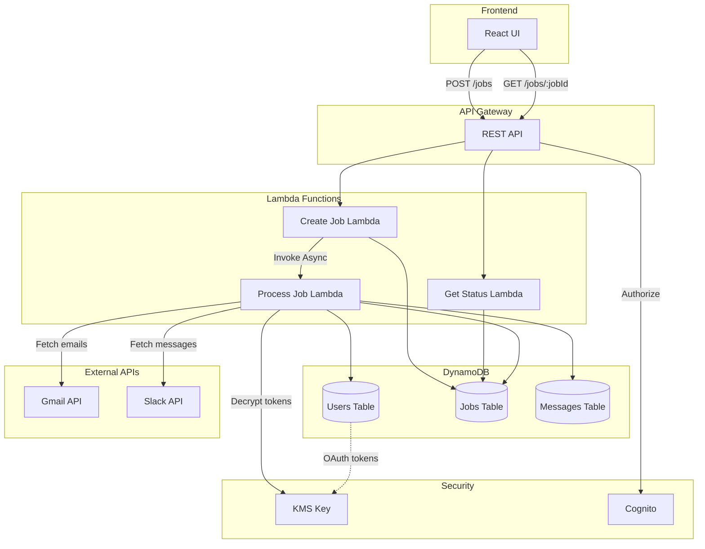

# Design Document: Data Ingestion Pipeline

## Overview

The Data Ingestion Pipeline is an asynchronous, event-driven system that retrieves workplace communications (Gmail and Slack) within user-specified timeframes and optional search criteria. The system normalizes, deduplicates, and stores messages in DynamoDB while tracking job status for frontend polling.

The pipeline consists of three primary Lambda functions orchestrated through API Gateway:
1. **Job Creation**: Validates input and creates job records
2. **Data Retrieval**: Fetches messages from Gmail and Slack APIs asynchronously
3. **Status Polling**: Returns job status for frontend consumption

This design leverages existing OAuth infrastructure (Gmail and Slack integration stacks) and extends the current DynamoDB schema with two new tables: Jobs and Messages.

## Architecture

### High-Level Architecture



### Component Interaction Flow

**Job Creation Flow:**
1. User submits data pull request via frontend
2. API Gateway authenticates via Cognito
3. Create Job Lambda validates input parameters
4. Job record created in Jobs table with status "PROCESSING"
5. Process Job Lambda invoked asynchronously
6. JobId returned to frontend within 500ms

**Data Retrieval Flow:**
1. Process Job Lambda retrieves user's OAuth tokens from Users table
2. Decrypts tokens using KMS
3. Fetches emails from Gmail API with exponential backoff
4. Fetches messages from Slack API with exponential backoff
5. Normalizes and deduplicates messages
6. Stores messages in Messages table
7. Updates job status to "DONE" or "FAILED"

**Status Polling Flow:**
1. Frontend polls GET /jobs/:jobId every 2 seconds
2. Get Status Lambda verifies user ownership
3. Returns current job status and metadata
4. Frontend stops polling when status is "DONE" or "FAILED"

## Components and Interfaces

### API Gateway Endpoints

#### POST /api/jobs
Creates a new data ingestion job.

**Authentication:** Cognito JWT token required

**Request Body:**
```typescript
{
  startDate: string;      // ISO 8601 format
  endDate: string;        // ISO 8601 format
  searchTopic?: string;   // Optional, 1-500 characters
}
```

**Response (201 Created):**
```typescript
{
  jobId: string;
  status: "PROCESSING";
  startDate: string;
  endDate: string;
  searchTopic?: string;
  createdAt: string;
}
```

**Error Responses:**
- 400: Invalid input (date format, range > 365 days, startDate > endDate)
- 401: Unauthorized (invalid/missing token)
- 429: Too many concurrent jobs (limit: 5)
- 500: Internal server error

#### GET /api/jobs/:jobId
Retrieves job status and metadata.

**Authentication:** Cognito JWT token required

**Response (200 OK):**
```typescript
{
  jobId: string;
  userId: string;
  status: "PROCESSING" | "DONE" | "FAILED";
  startDate: string;
  endDate: string;
  searchTopic?: string;
  createdAt: string;
  completedAt?: string;
  messageCount?: number;  // Only present when status is "DONE"
  errorMessage?: string;  // Only present when status is "FAILED"
}
```

**Error Responses:**
- 401: Unauthorized
- 403: Forbidden (user doesn't own this job)
- 404: Job not found
- 500: Internal server error

### Lambda Functions

#### Create Job Lambda

**Purpose:** Validates input, creates job record, and triggers async processing

**Runtime:** Node.js 22.x  
**Timeout:** 10 seconds  
**Memory:** 256 MB

**Environment Variables:**
- `JOBS_TABLE_NAME`: DynamoDB Jobs table name
- `PROCESS_JOB_FUNCTION_NAME`: ARN of Process Job Lambda

**Input:** API Gateway event with request body

**Validation Logic:**
1. Parse and validate ISO 8601 dates
2. Verify startDate ≤ endDate
3. Verify date range ≤ 365 days
4. Validate searchTopic length (1-500 chars if provided)
5. Query Jobs table for user's concurrent "PROCESSING" jobs
6. Reject if count ≥ 5

**Output:** Job record or error response

**IAM Permissions:**
- DynamoDB: PutItem, Query on Jobs table
- Lambda: InvokeFunction on Process Job Lambda

#### Process Job Lambda

**Purpose:** Fetches messages from Gmail and Slack, normalizes, deduplicates, and stores

**Runtime:** Node.js 22.x  
**Timeout:** 15 minutes (900 seconds)  
**Memory:** 1024 MB

**Environment Variables:**
- `USERS_TABLE_NAME`: DynamoDB Users table name
- `JOBS_TABLE_NAME`: DynamoDB Jobs table name
- `MESSAGES_TABLE_NAME`: DynamoDB Messages table name
- `KMS_KEY_ID`: KMS key ID for token decryption
- `GOOGLE_CLIENT_ID_PARAM`: SSM parameter path
- `GOOGLE_CLIENT_SECRET_PARAM`: SSM parameter path
- `SLACK_CLIENT_ID_PARAM`: SSM parameter path
- `SLACK_CLIENT_SECRET_PARAM`: SSM parameter path

**Processing Steps:**
1. Retrieve job record from Jobs table
2. Retrieve user record from Users table
3. Decrypt OAuth tokens using KMS
4. Fetch Gmail messages with retry logic
5. Fetch Slack messages with retry logic
6. Normalize messages to standard schema
7. Deduplicate within job scope
8. Batch write to Messages table
9. Update job status to "DONE" or "FAILED"

**Error Handling:**
- OAuth token invalid/expired → status "FAILED", error message recorded
- API rate limit → exponential backoff (max 5 retries)
- Transient errors → retry up to 3 times
- All errors logged to CloudWatch with jobId, userId, timestamp

**IAM Permissions:**
- DynamoDB: GetItem on Users table, UpdateItem on Jobs table, BatchWriteItem on Messages table
- KMS: Decrypt
- SSM: GetParameter
- CloudWatch: PutMetricData, CreateLogStream, PutLogEvents

#### Get Status Lambda

**Purpose:** Returns job status for frontend polling

**Runtime:** Node.js 22.x  
**Timeout:** 5 seconds  
**Memory:** 128 MB

**Environment Variables:**
- `JOBS_TABLE_NAME`: DynamoDB Jobs table name

**Processing Steps:**
1. Extract jobId from path parameters
2. Extract userId from Cognito claims
3. Query Jobs table for job record
4. Verify userId matches job owner
5. Return job status and metadata

**IAM Permissions:**
- DynamoDB: GetItem on Jobs table

## Data Models

### Jobs Table Schema

**Table Name:** `jobs`  
**Billing Mode:** PAY_PER_REQUEST  
**Partition Key:** `jobId` (String)

**Attributes:**
```typescript
{
  jobId: string;           // UUID v4
  userId: string;          // Internal user ID from Users table
  status: string;          // "PROCESSING" | "DONE" | "FAILED"
  startDate: string;       // ISO 8601 date
  endDate: string;         // ISO 8601 date
  searchTopic?: string;    // Optional search filter
  createdAt: string;       // ISO 8601 timestamp
  completedAt?: string;    // ISO 8601 timestamp (when status changes to DONE/FAILED)
  messageCount?: number;   // Count of messages retrieved (only for DONE status)
  errorMessage?: string;   // Error description (only for FAILED status)
}
```

**Global Secondary Index: UserIdStatusIndex**
- Partition Key: `userId` (String)
- Sort Key: `status` (String)
- Projection: ALL
- Purpose: Query user's jobs by status (e.g., count concurrent PROCESSING jobs)

**Global Secondary Index: UserIdCreatedAtIndex**
- Partition Key: `userId` (String)
- Sort Key: `createdAt` (String)
- Projection: ALL
- Purpose: List user's jobs chronologically

### Messages Table Schema

**Table Name:** `messages`  
**Billing Mode:** PAY_PER_REQUEST  
**Partition Key:** `jobId` (String)  
**Sort Key:** `messageId` (String)

**Attributes:**
```typescript
{
  jobId: string;           // Foreign key to Jobs table
  messageId: string;       // UUID v4
  source: string;          // "gmail" | "slack"
  subject: string;         // Email subject or empty string for Slack
  text: string;            // Message body (trimmed, normalized whitespace)
  timestamp: string;       // ISO 8601 timestamp from source system
  createdAt: string;       // ISO 8601 timestamp when stored
  sender: string;          // Email address or Slack user ID
  recipient: string;       // Email address or Slack channel ID
  deduplicationHash: string; // SHA-256 hash of (source + timestamp + sender + text)
}
```

**Global Secondary Index: JobIdTimestampIndex**
- Partition Key: `jobId` (String)
- Sort Key: `timestamp` (String)
- Projection: ALL
- Purpose: Retrieve messages for a job in chronological order

**Global Secondary Index: JobIdDeduplicationHashIndex**
- Partition Key: `jobId` (String)
- Sort Key: `deduplicationHash` (String)
- Projection: KEYS_ONLY
- Purpose: Fast deduplication check within job scope

### Users Table (Existing)

The existing Users table stores OAuth tokens encrypted with KMS:

```typescript
{
  internalUserId: string;  // Partition key
  cognitoUserId: string;   // GSI partition key
  email: string;
  gmailOAuthToken?: {
    accessToken: string;   // KMS encrypted
    refreshToken: string;  // KMS encrypted
    expiresAt: number;     // Unix timestamp
  };
  slackOAuthToken?: {
    accessToken: string;   // KMS encrypted
    refreshToken: string;  // KMS encrypted
    expiresAt: number;     // Unix timestamp
  };
}
```

### Message Normalization Logic

**Gmail Message Transformation:**
```typescript
{
  source: "gmail",
  subject: email.payload.headers.find(h => h.name === "Subject")?.value || "",
  text: extractTextFromGmailPayload(email.payload).trim().replace(/\s+/g, " "),
  timestamp: new Date(parseInt(email.internalDate)).toISOString(),
  sender: email.payload.headers.find(h => h.name === "From")?.value || "",
  recipient: email.payload.headers.find(h => h.name === "To")?.value || "",
}
```

**Slack Message Transformation:**
```typescript
{
  source: "slack",
  subject: "",  // Slack messages don't have subjects
  text: message.text.trim().replace(/\s+/g, " "),
  timestamp: new Date(parseFloat(message.ts) * 1000).toISOString(),
  sender: message.user,
  recipient: message.channel,
}
```

**Deduplication Hash Calculation:**
```typescript
const deduplicationHash = crypto
  .createHash('sha256')
  .update(`${source}:${timestamp}:${sender}:${text}`)
  .digest('hex');
```

### API Integration Patterns

#### Gmail API Integration

**Endpoint:** `GET https://gmail.googleapis.com/gmail/v1/users/me/messages`

**Query Parameters:**
- `q`: Search query combining date range and optional topic
  - Date format: `after:YYYY/MM/DD before:YYYY/MM/DD`
  - Topic filter: `subject:${searchTopic} OR body:${searchTopic}`
- `maxResults`: 500 (maximum per page)
- `pageToken`: For pagination

**Rate Limiting:**
- Quota: 250 quota units per user per second
- Strategy: Exponential backoff starting at 1 second, max 5 retries
- Backoff formula: `delay = min(2^attempt * 1000, 32000)` milliseconds

**Error Handling:**
- 401 Unauthorized → Mark job as FAILED, record "Gmail OAuth token expired"
- 429 Too Many Requests → Apply exponential backoff
- 403 Forbidden → Mark job as FAILED, record "Gmail API access denied"
- 5xx Server Error → Retry with exponential backoff

#### Slack API Integration

**Endpoint:** `GET https://slack.com/api/search.messages`

**Query Parameters:**
- `query`: Search query combining date range and optional topic
  - Date format: `after:YYYY-MM-DD before:YYYY-MM-DD`
  - Topic filter: `${searchTopic}` (if provided)
- `count`: 100 (maximum per page)
- `page`: For pagination

**Rate Limiting:**
- Tier 3: 50+ requests per minute
- Strategy: Exponential backoff starting at 1 second, max 5 retries
- Backoff formula: `delay = min(2^attempt * 1000, 32000)` milliseconds

**Error Handling:**
- `invalid_auth` → Mark job as FAILED, record "Slack OAuth token expired"
- `rate_limited` → Apply exponential backoff using `Retry-After` header
- `not_authed` → Mark job as FAILED, record "Slack authentication required"
- Network errors → Retry with exponential backoff

## Correctness Properties

*A property is a characteristic or behavior that should hold true across all valid executions of a system—essentially, a formal statement about what the system should do. Properties serve as the bridge between human-readable specifications and machine-verifiable correctness guarantees.*


### Property 1: Job Record Completeness

*For any* data pull request with valid parameters, the created job record should contain all required fields (jobId, userId, startDate, endDate, createdAt) and optionally searchTopic if provided in the request.

**Validates: Requirements 1.1, 1.3, 1.4**

### Property 2: Unique Job Identifiers

*For any* set of job creation requests, all generated jobIds should be unique across the system.

**Validates: Requirements 1.2**

### Property 3: Date Range Validation

*For any* data pull request, if startDate is after endDate, the system should reject the request with a validation error without creating a job record.

**Validates: Requirements 7.1**

### Property 4: Date Range Limit Validation

*For any* data pull request, if the date range exceeds 365 days, the system should reject the request with a validation error without creating a job record.

**Validates: Requirements 7.2**

### Property 5: ISO 8601 Date Validation

*For any* data pull request, if startDate or endDate is not a valid ISO 8601 formatted date, the system should reject the request with a validation error without creating a job record.

**Validates: Requirements 7.4**

### Property 6: Search Topic Length Validation

*For any* data pull request with a searchTopic, if the searchTopic length is not between 1 and 500 characters, the system should reject the request with a validation error without creating a job record.

**Validates: Requirements 7.5**

### Property 7: Validation Failure Prevents Job Creation

*For any* data pull request that fails validation, no job record should be created in the Jobs table.

**Validates: Requirements 7.3**

### Property 8: Concurrent Job Limit Enforcement

*For any* user with 5 or more jobs in "PROCESSING" status, attempting to create a new job should result in an error indicating the concurrent limit has been reached.

**Validates: Requirements 8.3**

### Property 9: Multiple Concurrent Jobs Support

*For any* user with fewer than 5 "PROCESSING" jobs, the system should allow creating additional jobs up to the limit.

**Validates: Requirements 8.1**

### Property 10: OAuth Token Retrieval

*For any* job being processed, the system should retrieve the user's OAuth tokens for both Gmail and Slack from the Users table.

**Validates: Requirements 2.1, 3.1**

### Property 11: Complete Message Retrieval

*For any* job with a date range, all messages from Gmail and Slack within that date range should be fetched and stored.

**Validates: Requirements 2.2, 3.2**

### Property 12: Search Topic Filtering

*For any* job with a searchTopic, only messages containing the searchTopic text should be retrieved from both Gmail and Slack.

**Validates: Requirements 2.3, 3.3**

### Property 13: Exponential Backoff for Rate Limits

*For any* API rate limit response from Gmail or Slack, the system should retry with exponential backoff up to a maximum of 5 attempts before failing.

**Validates: Requirements 2.5, 3.5**

### Property 14: Complete Message Normalization

*For any* retrieved message from Gmail or Slack, the normalized message should contain all required fields (source, subject, text, timestamp, createdAt, sender, recipient, messageId, jobId, deduplicationHash) with correct values extracted from the source.

**Validates: Requirements 4.1, 4.3, 4.6**

### Property 15: Whitespace Normalization

*For any* message text, the normalized version should have leading/trailing whitespace removed and consecutive spaces reduced to a single space.

**Validates: Requirements 4.2**

### Property 16: Timestamp Preservation

*For any* message, the timestamp field in the normalized message should exactly match the original timestamp from the source system.

**Validates: Requirements 4.4**

### Property 17: Empty Subject for Slack Messages

*For any* Slack message, the normalized message should have an empty string as the subject field.

**Validates: Requirements 4.5**

### Property 18: Deduplication Hash Computation

*For any* message, the deduplicationHash should be a SHA-256 hash computed from the concatenation of source, timestamp, sender, and text fields.

**Validates: Requirements 9.1**

### Property 19: Within-Job Deduplication

*For any* job, if two messages have the same deduplicationHash, only the first occurrence should be stored in the Messages table.

**Validates: Requirements 9.2**

### Property 20: Cross-Job Message Allowance

*For any* message with the same deduplicationHash, it should be allowed to exist in multiple different jobs.

**Validates: Requirements 9.3**

### Property 21: Timestamp Uniqueness in Deduplication

*For any* two messages with identical source, sender, and text but different timestamps, they should be treated as distinct messages and both stored.

**Validates: Requirements 9.5**

### Property 22: Job Status Transitions with Timestamps

*For any* job, when processing completes successfully, the status should be updated to "DONE" with a completedAt timestamp; when processing fails, the status should be updated to "FAILED" with a completedAt timestamp.

**Validates: Requirements 5.1, 5.2, 5.3**

### Property 23: Error Message Storage for Failed Jobs

*For any* job with status "FAILED", the job record should contain an errorMessage field describing the failure reason.

**Validates: Requirements 5.4**

### Property 24: Transient Error Retry Logic

*For any* transient error during job processing, the system should retry the operation up to 3 times before marking the job as "FAILED".

**Validates: Requirements 10.3**

### Property 25: Status Response Completeness

*For any* job status request, the response should include all required fields (jobId, userId, status, startDate, endDate, createdAt) and conditionally include completedAt, messageCount (for DONE), and errorMessage (for FAILED).

**Validates: Requirements 6.2**

### Property 26: Job Ownership Verification

*For any* job status request, the system should verify that the requesting user's userId matches the job's userId before returning status information.

**Validates: Requirements 6.4**

### Property 27: Message Count for Completed Jobs

*For any* job with status "DONE", the status response should include the count of messages retrieved and stored.

**Validates: Requirements 6.5**

## Error Handling

### Error Categories

**Validation Errors (4xx):**
- Invalid date format → 400 Bad Request
- Date range exceeds 365 days → 400 Bad Request
- startDate after endDate → 400 Bad Request
- searchTopic length invalid → 400 Bad Request
- Missing required fields → 400 Bad Request
- Unauthorized request → 401 Unauthorized
- User doesn't own job → 403 Forbidden
- Job not found → 404 Not Found
- Concurrent job limit exceeded → 429 Too Many Requests

**OAuth Errors:**
- Invalid/expired Gmail token → Job status "FAILED", error: "Gmail OAuth token expired or invalid"
- Invalid/expired Slack token → Job status "FAILED", error: "Slack OAuth token expired or invalid"
- Missing OAuth tokens → Job status "FAILED", error: "OAuth tokens not found for user"

**API Errors:**
- Gmail API rate limit → Exponential backoff, max 5 retries, then "FAILED"
- Slack API rate limit → Exponential backoff, max 5 retries, then "FAILED"
- Gmail API 403 Forbidden → Job status "FAILED", error: "Gmail API access denied"
- Slack API authentication error → Job status "FAILED", error: "Slack authentication failed"
- Network timeout → Retry up to 3 times, then "FAILED"

**System Errors (5xx):**
- DynamoDB throttling → Retry with exponential backoff
- KMS decryption failure → Job status "FAILED", error: "Failed to decrypt OAuth tokens"
- Lambda timeout → Job status "FAILED", error: "Processing timeout exceeded"
- Unexpected errors → Job status "FAILED", error logged to CloudWatch

### Retry Strategies

**Exponential Backoff Configuration:**
```typescript
const retryConfig = {
  maxRetries: 5,
  baseDelay: 1000,      // 1 second
  maxDelay: 32000,      // 32 seconds
  multiplier: 2,
};

function calculateDelay(attempt: number): number {
  return Math.min(
    retryConfig.baseDelay * Math.pow(retryConfig.multiplier, attempt),
    retryConfig.maxDelay
  );
}
```

**Retry Attempts:**
- Attempt 1: 1 second delay
- Attempt 2: 2 seconds delay
- Attempt 3: 4 seconds delay
- Attempt 4: 8 seconds delay
- Attempt 5: 16 seconds delay

**Transient Error Retry:**
- Network errors: 3 retries
- DynamoDB throttling: 3 retries
- 5xx server errors: 3 retries

### Error Logging

All errors logged to CloudWatch with structured format:
```typescript
{
  timestamp: string;      // ISO 8601
  level: "ERROR" | "WARN";
  jobId: string;
  userId: string;
  errorType: string;      // "VALIDATION" | "OAUTH" | "API" | "SYSTEM"
  errorMessage: string;
  errorDetails: object;   // Stack trace, API response, etc.
  retryAttempt?: number;
}
```

### CloudWatch Metrics

**Custom Metrics Emitted:**
- `JobCreated`: Count of jobs created
- `JobCompleted`: Count of jobs completed successfully
- `JobFailed`: Count of jobs failed
- `MessagesFetched`: Count of messages retrieved per job
- `MessagesDeduplicated`: Count of duplicate messages filtered
- `APIRetries`: Count of API retry attempts
- `ProcessingDuration`: Time taken to process job (milliseconds)

**Metric Dimensions:**
- `UserId`: User identifier
- `Source`: "gmail" | "slack"
- `ErrorType`: Error category

## Testing Strategy

### Dual Testing Approach

This feature requires both unit tests and property-based tests for comprehensive coverage:

**Unit Tests** focus on:
- Specific examples of valid and invalid inputs
- Edge cases (empty results, maximum date range, etc.)
- Error conditions (expired tokens, API failures)
- Integration points between components
- Mock API responses

**Property-Based Tests** focus on:
- Universal properties that hold for all inputs
- Comprehensive input coverage through randomization
- Invariants that must always be true
- Round-trip properties (normalization/denormalization)

### Property-Based Testing Configuration

**Library:** fast-check (for TypeScript/Node.js)

**Configuration:**
- Minimum 100 iterations per property test
- Each test tagged with feature name and property number
- Tag format: `Feature: data-ingestion-pipeline, Property {number}: {property_text}`

**Example Property Test Structure:**
```typescript
import fc from 'fast-check';

describe('Feature: data-ingestion-pipeline, Property 3: Date Range Validation', () => {
  it('should reject requests where startDate is after endDate', () => {
    fc.assert(
      fc.property(
        fc.date(), // Generate random dates
        fc.date(),
        (date1, date2) => {
          const [startDate, endDate] = date1 > date2 
            ? [date2, date1] 
            : [date1, date2];
          
          // When startDate > endDate, expect validation error
          if (startDate > endDate) {
            const result = validateDateRange(startDate, endDate);
            expect(result.isValid).toBe(false);
            expect(result.error).toContain('startDate must be before or equal to endDate');
          }
        }
      ),
      { numRuns: 100 }
    );
  });
});
```

### Unit Test Coverage

**Create Job Lambda:**
- Valid job creation with all fields
- Valid job creation with optional searchTopic
- Validation errors for each constraint
- Concurrent job limit enforcement
- Async invocation of Process Job Lambda

**Process Job Lambda:**
- Successful message retrieval from Gmail
- Successful message retrieval from Slack
- OAuth token decryption
- Message normalization for Gmail
- Message normalization for Slack
- Deduplication within job
- Exponential backoff on rate limits
- Error handling for expired tokens
- Job status updates

**Get Status Lambda:**
- Status retrieval for existing job
- Error for non-existent job
- Ownership verification
- Conditional fields (messageCount, errorMessage)

### Integration Tests

**End-to-End Flow:**
1. Create job via API Gateway
2. Verify job record in DynamoDB
3. Mock Gmail/Slack API responses
4. Verify messages stored in DynamoDB
5. Poll status until "DONE"
6. Verify final job status and message count

**Error Scenarios:**
1. Expired OAuth token → Job fails with appropriate error
2. API rate limit → Retries with backoff, eventually succeeds
3. Network timeout → Retries, then fails
4. Concurrent job limit → Request rejected

### Performance Testing

**Load Testing:**
- Concurrent job creation (multiple users)
- Large message volumes (1000+ messages per job)
- API Gateway throttling behavior
- DynamoDB throughput under load

**Latency Testing:**
- Job creation response time (target: <500ms)
- Status polling response time (target: <200ms)
- End-to-end processing time for various message volumes

### Test Data Generators

**For Property-Based Tests:**
```typescript
// Generate valid date ranges
const dateRangeArbitrary = fc.tuple(
  fc.date({ min: new Date('2020-01-01'), max: new Date('2025-12-31') }),
  fc.date({ min: new Date('2020-01-01'), max: new Date('2025-12-31') })
).map(([d1, d2]) => d1 <= d2 ? [d1, d2] : [d2, d1]);

// Generate search topics
const searchTopicArbitrary = fc.string({ minLength: 1, maxLength: 500 });

// Generate Gmail messages
const gmailMessageArbitrary = fc.record({
  id: fc.uuid(),
  internalDate: fc.integer({ min: 1000000000000, max: 9999999999999 }),
  payload: fc.record({
    headers: fc.array(fc.record({
      name: fc.constantFrom('From', 'To', 'Subject'),
      value: fc.string()
    })),
    body: fc.record({
      data: fc.base64String()
    })
  })
});

// Generate Slack messages
const slackMessageArbitrary = fc.record({
  ts: fc.float({ min: 1000000000, max: 9999999999 }).map(String),
  user: fc.string(),
  channel: fc.string(),
  text: fc.string()
});
```

### Mocking Strategy

**AWS SDK Mocks:**
- DynamoDB: Use aws-sdk-mock or DynamoDB Local
- KMS: Mock encrypt/decrypt operations
- SSM: Mock parameter retrieval
- Lambda: Mock async invocation

**External API Mocks:**
- Gmail API: Mock HTTP responses with nock or msw
- Slack API: Mock HTTP responses with nock or msw
- Simulate rate limits, errors, pagination

**Example Mock:**
```typescript
import nock from 'nock';

// Mock Gmail API rate limit response
nock('https://gmail.googleapis.com')
  .get('/gmail/v1/users/me/messages')
  .query(true)
  .reply(429, {
    error: {
      code: 429,
      message: 'Rate limit exceeded'
    }
  });
```

### Test Execution

**Local Development:**
```bash
npm test                          # Run all tests
npm test -- --coverage            # Run with coverage report
npm test -- --watch               # Watch mode for development
npm test -- create-job.test.ts    # Run specific test file
```

**CI/CD Pipeline:**
- Run all tests on every pull request
- Require 80% code coverage minimum
- Run integration tests against deployed stack
- Performance tests on staging environment

### Test Organization

```
backend/
├── lambda/
│   ├── data-ingestion/
│   │   ├── create-job.ts
│   │   ├── create-job.test.ts           # Unit tests
│   │   ├── create-job.property.test.ts  # Property-based tests
│   │   ├── process-job.ts
│   │   ├── process-job.test.ts
│   │   ├── process-job.property.test.ts
│   │   ├── get-status.ts
│   │   ├── get-status.test.ts
│   │   ├── get-status.property.test.ts
│   │   └── shared/
│   │       ├── normalization.ts
│   │       ├── normalization.test.ts
│   │       ├── normalization.property.test.ts
│   │       ├── validation.ts
│   │       ├── validation.test.ts
│   │       └── validation.property.test.ts
│   └── ...
└── test/
    └── integration/
        └── data-ingestion-pipeline.test.ts
```
