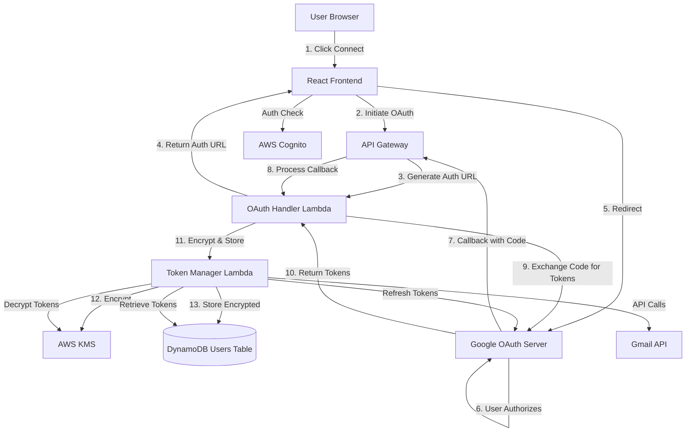
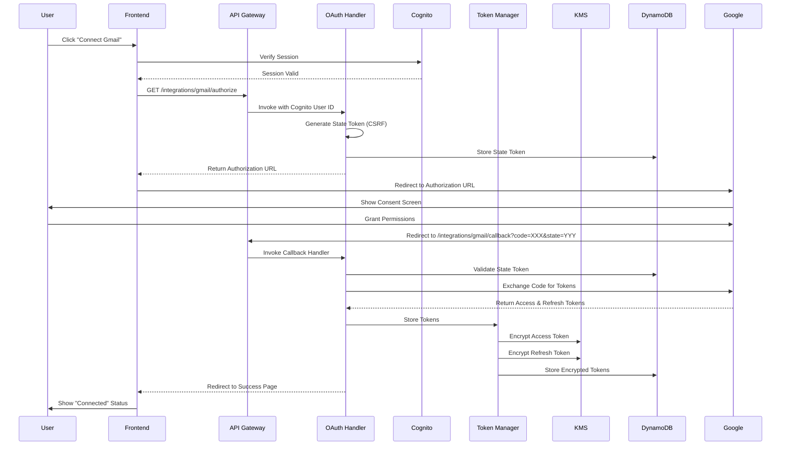

# Design Document: Gmail Integration

## Overview

The Gmail Integration feature enables FlowRecall users to securely connect their Gmail accounts through OAuth 2.0, allowing the system to access email communications for timeline reconstruction and catch-up brief generation. This design implements a complete OAuth flow with secure token storage using AWS KMS encryption, automatic token refresh, and a user-friendly integration management interface.

The system follows AWS best practices for security and scalability, leveraging existing infrastructure (Cognito, DynamoDB, Lambda) while adding new components for OAuth handling, token management, and API Gateway endpoints.

### Key Design Goals

- **Security First**: All OAuth tokens encrypted at rest using AWS KMS, with secure transmission and no logging of sensitive data
- **Seamless UX**: Single-click connection flow with clear status feedback and automatic token refresh
- **Scalability**: Serverless architecture using Lambda and DynamoDB for automatic scaling
- **Maintainability**: Clear separation of concerns between OAuth handling, token management, and UI components
- **Reliability**: Comprehensive error handling with graceful degradation and user-friendly error messages

## Architecture

### High-Level Architecture



### OAuth 2.0 Flow Sequence



### Component Architecture

The system is organized into four main layers:

1. **Presentation Layer** (React Frontend)
   - IntegrationsPage component with Gmail connection UI
   - OAuth state management and callback handling
   - Status display and error messaging

2. **API Layer** (API Gateway + Lambda)
   - OAuth initiation endpoint
   - OAuth callback handler
   - Status check endpoint
   - Disconnect endpoint

3. **Business Logic Layer** (Lambda Functions)
   - OAuth Handler: Manages OAuth flow and token exchange
   - Token Manager: Handles encryption, storage, and refresh
   - Integration Service: Provides status and management operations

4. **Data Layer** (DynamoDB + KMS)
   - Users table with encrypted token storage
   - KMS for encryption/decryption operations
   - State token storage for CSRF protection

## Components and Interfaces

### Frontend Components

#### IntegrationsPage Component (Enhanced)

**Location**: `frontend/src/pages/Integrations.tsx`

**Responsibilities**:
- Display available integrations (Gmail, Calendar, Slack)
- Show connection status for each integration
- Handle OAuth flow initiation
- Process OAuth callbacks
- Display error messages and loading states

**State Management**:
```typescript
interface IntegrationState {
  id: string;
  name: string;
  status: 'connected' | 'disconnected' | 'connecting' | 'error';
  connectedEmail?: string;
  connectedAt?: string;
  error?: string;
}
```

**Key Methods**:
- `handleConnect(integrationId: string)`: Initiates OAuth flow
- `handleDisconnect(integrationId: string)`: Removes integration
- `fetchIntegrationStatus()`: Loads current status from backend
- `handleOAuthCallback()`: Processes OAuth redirect

**API Interactions**:
- `GET /api/integrations/status` - Fetch all integration statuses
- `GET /api/integrations/gmail/authorize` - Get OAuth URL
- `POST /api/integrations/gmail/disconnect` - Remove integration

#### GmailIntegrationCard Component (New)

**Location**: `frontend/src/components/GmailIntegrationCard.tsx`

**Responsibilities**:
- Display Gmail-specific integration card
- Show connection status and connected email
- Render Connect/Disconnect buttons
- Display loading and error states

**Props**:
```typescript
interface GmailIntegrationCardProps {
  status: 'connected' | 'disconnected' | 'connecting' | 'error';
  connectedEmail?: string;
  connectedAt?: string;
  error?: string;
  onConnect: () => void;
  onDisconnect: () => void;
}
```

### Backend Components

#### API Gateway Configuration

**Base Path**: `/api/integrations/gmail`

**Endpoints**:

1. **GET /authorize**
   - Purpose: Initiate OAuth flow
   - Auth: Cognito Authorizer (required)
   - Response: `{ authorizationUrl: string }`
   - Lambda: OAuthInitiationHandler

2. **GET /callback**
   - Purpose: Handle OAuth callback from Google
   - Auth: None (public endpoint with state validation)
   - Query Params: `code`, `state`, `error`
   - Response: Redirect to frontend with status
   - Lambda: OAuthCallbackHandler

3. **GET /status**
   - Purpose: Check Gmail connection status
   - Auth: Cognito Authorizer (required)
   - Response: `{ status: string, email?: string, connectedAt?: string }`
   - Lambda: IntegrationStatusHandler

4. **POST /disconnect**
   - Purpose: Disconnect Gmail integration
   - Auth: Cognito Authorizer (required)
   - Response: `{ success: boolean }`
   - Lambda: IntegrationDisconnectHandler

#### Lambda Functions

##### OAuthInitiationHandler

**Purpose**: Generate OAuth authorization URL with state token

**Input**:
```typescript
interface InitiationRequest {
  cognitoUserId: string; // From Cognito authorizer
}
```

**Process**:
1. Validate Cognito session
2. Generate cryptographically secure state token
3. Store state token in DynamoDB with expiration (5 minutes)
4. Build Google OAuth URL with required scopes
5. Return authorization URL to frontend

**Output**:
```typescript
interface InitiationResponse {
  authorizationUrl: string;
}
```

**Environment Variables**:
- `GOOGLE_CLIENT_ID`: OAuth client ID
- `GOOGLE_CLIENT_SECRET`: OAuth client secret (from Secrets Manager)
- `OAUTH_REDIRECT_URI`: Callback URL
- `USERS_TABLE_NAME`: DynamoDB table name
- `STATE_TOKEN_TTL`: State token expiration (300 seconds)

##### OAuthCallbackHandler

**Purpose**: Process OAuth callback and exchange code for tokens

**Input**:
```typescript
interface CallbackRequest {
  code: string;
  state: string;
  error?: string;
}
```

**Process**:
1. Validate state token from DynamoDB
2. Retrieve associated Cognito user ID
3. Exchange authorization code for tokens with Google
4. Extract access token, refresh token, and expiration
5. Call Token Manager to encrypt and store tokens
6. Delete used state token
7. Redirect to frontend with success/error status

**Output**: HTTP redirect to frontend

**Error Handling**:
- Invalid state: Redirect with error=invalid_state
- Token exchange failure: Redirect with error=token_exchange_failed
- Storage failure: Redirect with error=storage_failed

##### TokenManagerHandler

**Purpose**: Encrypt, decrypt, store, and refresh OAuth tokens

**Methods**:

1. **storeTokens**
   ```typescript
   interface StoreTokensRequest {
     cognitoUserId: string;
     accessToken: string;
     refreshToken: string;
     expiresIn: number;
     email: string;
   }
   ```
   - Encrypts tokens using KMS
   - Stores in DynamoDB Users table
   - Updates integration status to 'connected'

2. **getTokens**
   ```typescript
   interface GetTokensRequest {
     cognitoUserId: string;
   }
   
   interface GetTokensResponse {
     accessToken: string;
     refreshToken: string;
     expiresAt: number;
     email: string;
   }
   ```
   - Retrieves encrypted tokens from DynamoDB
   - Decrypts using KMS
   - Checks expiration and refreshes if needed

3. **refreshTokens**
   ```typescript
   interface RefreshTokensRequest {
     cognitoUserId: string;
     refreshToken: string;
   }
   ```
   - Calls Google OAuth token refresh endpoint
   - Encrypts new access token
   - Updates DynamoDB with new token and expiration

4. **deleteTokens**
   ```typescript
   interface DeleteTokensRequest {
     cognitoUserId: string;
   }
   ```
   - Retrieves tokens from DynamoDB
   - Revokes tokens with Google
   - Deletes from DynamoDB
   - Updates integration status to 'disconnected'

**Environment Variables**:
- `KMS_KEY_ID`: KMS key ARN for encryption
- `USERS_TABLE_NAME`: DynamoDB table name
- `GOOGLE_CLIENT_ID`: OAuth client ID
- `GOOGLE_CLIENT_SECRET`: OAuth client secret

##### IntegrationStatusHandler

**Purpose**: Return current Gmail integration status

**Input**:
```typescript
interface StatusRequest {
  cognitoUserId: string; // From Cognito authorizer
}
```

**Process**:
1. Query DynamoDB Users table by Cognito user ID
2. Check for Gmail integration fields
3. Validate token expiration
4. Return status and metadata

**Output**:
```typescript
interface StatusResponse {
  status: 'connected' | 'disconnected' | 'expired';
  email?: string;
  connectedAt?: string;
}
```

##### IntegrationDisconnectHandler

**Purpose**: Disconnect Gmail integration

**Input**:
```typescript
interface DisconnectRequest {
  cognitoUserId: string; // From Cognito authorizer
}
```

**Process**:
1. Call Token Manager to delete tokens
2. Token Manager revokes with Google
3. Remove integration fields from DynamoDB
4. Return success response

**Output**:
```typescript
interface DisconnectResponse {
  success: boolean;
}
```

### AWS Infrastructure Components

#### KMS Key Configuration

**Purpose**: Encrypt/decrypt OAuth tokens

**Configuration**:
- Key Type: Symmetric
- Key Spec: SYMMETRIC_DEFAULT
- Key Usage: ENCRYPT_DECRYPT
- Key Policy: Allow Lambda execution roles to encrypt/decrypt
- Rotation: Enabled (annual)
- Alias: `alias/flowrecall-oauth-tokens`

**Permissions**:
- Lambda functions: `kms:Encrypt`, `kms:Decrypt`, `kms:GenerateDataKey`
- CloudWatch Logs: `kms:Decrypt` (for encrypted log data)

#### DynamoDB Users Table Schema Updates

**Existing Schema**:
- Partition Key: `internalUserId` (String)
- GSI: `cognitoUserIdIndex` on `cognitoUserId`

**New Attributes for Gmail Integration**:

```typescript
interface UserRecord {
  // Existing fields
  internalUserId: string;
  cognitoUserId: string;
  email: string;
  createdAt: string;
  
  // New Gmail integration fields
  gmailIntegration?: {
    status: 'connected' | 'disconnected' | 'error';
    encryptedAccessToken?: string;  // KMS encrypted
    encryptedRefreshToken?: string; // KMS encrypted
    tokenExpiresAt?: number;        // Unix timestamp
    connectedEmail?: string;        // Gmail address
    connectedAt?: string;           // ISO timestamp
    lastRefreshedAt?: string;       // ISO timestamp
    errorMessage?: string;          // Last error if status='error'
  };
  
  // OAuth state tokens (temporary)
  oauthStateTokens?: {
    [state: string]: {
      createdAt: number;
      expiresAt: number;
    };
  };
}
```

**Encryption Strategy**:
- Access tokens and refresh tokens are encrypted using KMS before storage
- Encrypted tokens are stored as base64-encoded strings
- Email addresses and timestamps are stored in plaintext (not sensitive)
- State tokens are temporary and don't require encryption

**TTL Configuration**:
- Consider adding TTL attribute for expired state tokens
- State tokens expire after 5 minutes
- Automatic cleanup via DynamoDB TTL

#### API Gateway Configuration

**API Type**: REST API (existing or new)

**Authorizer Configuration**:
- Type: Cognito User Pool Authorizer
- User Pool: Existing FlowRecall user pool
- Token Source: Authorization header
- Token Validation: Automatic via Cognito

**CORS Configuration**:
```typescript
{
  allowOrigins: ['http://localhost:5173', 'https://app.flowrecall.com'],
  allowMethods: ['GET', 'POST', 'OPTIONS'],
  allowHeaders: ['Content-Type', 'Authorization'],
  allowCredentials: true
}
```

**Rate Limiting**:
- Throttle: 10 requests per second per user
- Burst: 20 requests
- Quota: 1000 requests per day per user

## Data Models

### OAuth State Token Model

**Purpose**: CSRF protection for OAuth flow

```typescript
interface OAuthStateToken {
  state: string;              // Cryptographically random string (32 bytes)
  cognitoUserId: string;      // Associated user
  createdAt: number;          // Unix timestamp
  expiresAt: number;          // Unix timestamp (createdAt + 300 seconds)
  integrationId: string;      // 'gmail'
}
```

**Storage**: DynamoDB Users table, nested under `oauthStateTokens` map

**Lifecycle**:
1. Created when user initiates OAuth flow
2. Validated when OAuth callback is received
3. Deleted after successful validation
4. Auto-expires after 5 minutes via TTL

### Gmail Integration Model

**Purpose**: Store Gmail OAuth tokens and metadata

```typescript
interface GmailIntegration {
  status: 'connected' | 'disconnected' | 'error';
  encryptedAccessToken?: string;   // Base64-encoded KMS ciphertext
  encryptedRefreshToken?: string;  // Base64-encoded KMS ciphertext
  tokenExpiresAt?: number;         // Unix timestamp
  connectedEmail?: string;         // Gmail address (e.g., user@gmail.com)
  connectedAt?: string;            // ISO 8601 timestamp
  lastRefreshedAt?: string;        // ISO 8601 timestamp
  errorMessage?: string;           // Last error message if status='error'
}
```

**Storage**: DynamoDB Users table, nested under `gmailIntegration` attribute

**State Transitions**:
- `disconnected` → `connected`: Successful OAuth flow
- `connected` → `error`: Token refresh failure
- `error` → `connected`: Successful reconnection
- `connected` → `disconnected`: User-initiated disconnect

### Google OAuth Token Response

**Purpose**: Model for Google's token endpoint response

```typescript
interface GoogleTokenResponse {
  access_token: string;      // Short-lived access token (1 hour)
  refresh_token?: string;    // Long-lived refresh token (only on first auth)
  expires_in: number;        // Seconds until access token expires
  scope: string;             // Granted scopes (space-separated)
  token_type: string;        // Always "Bearer"
}
```

**Scopes Requested**:
- `https://www.googleapis.com/auth/gmail.readonly` - Read-only access to Gmail
- `https://www.googleapis.com/auth/gmail.metadata` - Access to message metadata
- `https://www.googleapis.com/auth/userinfo.email` - User's email address

### API Request/Response Models

#### Authorization Initiation

**Request**: GET `/api/integrations/gmail/authorize`
- Headers: `Authorization: Bearer <cognito-token>`

**Response**:
```typescript
{
  authorizationUrl: string;  // Full Google OAuth URL with parameters
}
```

#### OAuth Callback

**Request**: GET `/api/integrations/gmail/callback?code=XXX&state=YYY`
- No authorization required (public endpoint)

**Response**: HTTP 302 Redirect
- Success: `https://app.flowrecall.com/integrations?gmail=connected`
- Error: `https://app.flowrecall.com/integrations?gmail=error&message=<error>`

#### Status Check

**Request**: GET `/api/integrations/gmail/status`
- Headers: `Authorization: Bearer <cognito-token>`

**Response**:
```typescript
{
  status: 'connected' | 'disconnected' | 'error';
  email?: string;           // Connected Gmail address
  connectedAt?: string;     // ISO 8601 timestamp
  errorMessage?: string;    // Error details if status='error'
}
```

#### Disconnect

**Request**: POST `/api/integrations/gmail/disconnect`
- Headers: `Authorization: Bearer <cognito-token>`

**Response**:
```typescript
{
  success: boolean;
  message?: string;  // Error message if success=false
}
```


## Correctness Properties

*A property is a characteristic or behavior that should hold true across all valid executions of a system—essentially, a formal statement about what the system should do. Properties serve as the bridge between human-readable specifications and machine-verifiable correctness guarantees.*

### Property Reflection

After analyzing all acceptance criteria, I identified several areas of redundancy:

1. **OAuth scope properties (1.3, 9.1, 9.2, 9.3, 9.4)** can be combined into a single comprehensive property that validates all required scopes are present and forbidden scopes are absent.

2. **Token encryption properties (3.1, 3.2)** can be combined since both access and refresh tokens follow the same encryption process.

3. **UI state display properties (1.1, 5.1, 5.2, 5.3, 6.1, 6.4)** are examples of specific UI states rather than universal properties, so they remain as examples.

4. **State parameter validation (1.4, 2.1)** can be combined into a single property about CSRF protection.

5. **Token storage and retrieval (3.3, 3.4, 3.5)** form a round-trip property: storing then retrieving tokens should return the original values.

6. **Cognito session validation (10.1, 10.2)** can be combined into a single property about authentication requirements.

7. **User authorization checks (10.3, 10.4)** can be combined into a single property about token ownership validation.

The following properties represent the unique, non-redundant correctness requirements:

### Property 1: OAuth Flow Initiation

*For any* authenticated Cognito user, when initiating the Gmail OAuth flow, the system should generate an authorization URL that includes a cryptographically secure state token, all required OAuth scopes, and the correct redirect URI.

**Validates: Requirements 1.2, 1.3, 1.4, 1.5**

### Property 2: OAuth Scope Configuration

*For any* OAuth authorization URL generated by the system, it should include the scopes `gmail.readonly`, `gmail.metadata`, and `userinfo.email`, and should NOT include any write or send scopes (e.g., `gmail.compose`, `gmail.send`).

**Validates: Requirements 9.1, 9.2, 9.3, 9.4**

### Property 3: State Token CSRF Protection

*For any* OAuth callback request, the system should only proceed with token exchange if the state parameter matches a valid, non-expired state token stored in the database for the associated user.

**Validates: Requirements 2.1, 2.3**

### Property 4: Token Exchange on Valid State

*For any* valid OAuth callback with a matching state token, the system should exchange the authorization code with Google and receive access and refresh tokens.

**Validates: Requirements 2.2, 2.5**

### Property 5: Token Encryption Round Trip

*For any* OAuth token (access or refresh), encrypting it with KMS then decrypting it should return the original token value unchanged.

**Validates: Requirements 3.1, 3.2, 3.5**

### Property 6: Token Storage with User Association

*For any* Cognito user and set of OAuth tokens, storing the tokens should result in them being retrievable only by the same Cognito user ID, with all token metadata (expiration, email) preserved.

**Validates: Requirements 3.3, 3.4, 10.3**

### Property 7: Token Ownership Authorization

*For any* token retrieval request, the system should only return tokens if the requesting Cognito user ID matches the user ID associated with the stored tokens.

**Validates: Requirements 10.4**

### Property 8: Automatic Token Refresh

*For any* expired access token with a valid refresh token, the Token Manager should automatically obtain a new access token from Google, encrypt it, and update the database before making Gmail API requests.

**Validates: Requirements 4.1, 4.2, 4.5**

### Property 9: Refresh Failure Disconnection

*For any* token refresh attempt that fails due to an invalid or expired refresh token, the system should mark the integration status as 'disconnected' and remove the tokens from storage.

**Validates: Requirements 4.3, 8.4**

### Property 10: Status Fetch on Page Load

*For any* user visiting the Integrations page, the system should fetch and display the current Gmail connection status without requiring manual refresh.

**Validates: Requirements 5.4**

### Property 11: Reactive Status Updates

*For any* successful OAuth connection or disconnection, the Integration UI should update the displayed status immediately without requiring a page reload.

**Validates: Requirements 5.5**

### Property 12: Token Removal on Disconnect

*For any* connected Gmail integration, when the user clicks Disconnect, the system should remove all encrypted tokens from the database and attempt to revoke them with Google.

**Validates: Requirements 6.2, 6.3**

### Property 13: Graceful Revocation Failure

*For any* disconnect operation where Google token revocation fails, the system should still remove the tokens from the database and log the error, allowing the disconnect to complete.

**Validates: Requirements 6.5**

### Property 14: Error Message Persistence

*For any* error that occurs during OAuth flow or token operations, the Integration UI should display the error message for at least 5 seconds before allowing retry.

**Validates: Requirements 8.5**

### Property 15: Authentication Requirement

*For any* OAuth flow initiation or token operation, the system should verify the user has a valid Cognito session and redirect to login if the session is invalid or expired.

**Validates: Requirements 10.1, 10.2**

### Property 16: Token Exchange Error Handling

*For any* token exchange failure (network error, invalid code, etc.), the OAuth Handler should return a user-friendly error message and log the detailed error for debugging.

**Validates: Requirements 2.4**

## Error Handling

### Error Categories

The Gmail integration handles four main categories of errors:

1. **User-Initiated Errors**
   - User cancels OAuth flow
   - User denies permissions
   - User disconnects integration

2. **Authentication Errors**
   - Invalid or expired Cognito session
   - Invalid state token (CSRF attack)
   - Mismatched user ID on token retrieval

3. **External Service Errors**
   - Google OAuth service unavailable
   - Token exchange failure
   - Token refresh failure
   - Gmail API errors

4. **System Errors**
   - KMS encryption/decryption failure
   - DynamoDB read/write failure
   - Lambda timeout or crash

### Error Handling Strategies

#### OAuth Flow Errors

**Scenario**: User cancels OAuth or denies permissions
- **Detection**: Google redirects with `error=access_denied`
- **Response**: Redirect to frontend with error message
- **User Experience**: Display "Connection cancelled" message
- **Recovery**: User can retry connection

**Scenario**: Invalid state token (potential CSRF attack)
- **Detection**: State parameter doesn't match stored token
- **Response**: Reject request, log security event
- **User Experience**: Display "Invalid request" error
- **Recovery**: User must restart OAuth flow

**Scenario**: Token exchange fails
- **Detection**: Google returns error from token endpoint
- **Response**: Log error details, return generic error to user
- **User Experience**: Display "Connection failed, please try again"
- **Recovery**: User can retry connection

#### Token Management Errors

**Scenario**: KMS encryption fails
- **Detection**: KMS API returns error
- **Response**: Log error, mark integration as error state
- **User Experience**: Display "Unable to secure connection"
- **Recovery**: Retry or contact support

**Scenario**: Token refresh fails (expired refresh token)
- **Detection**: Google returns invalid_grant error
- **Response**: Mark integration as disconnected, notify user
- **User Experience**: Display "Connection expired, please reconnect"
- **Recovery**: User must reconnect Gmail

**Scenario**: DynamoDB write fails
- **Detection**: DynamoDB API returns error
- **Response**: Log error, retry with exponential backoff (3 attempts)
- **User Experience**: Display "Connection in progress" during retries
- **Recovery**: Automatic retry or manual retry

#### Authentication Errors

**Scenario**: Expired Cognito session
- **Detection**: Cognito authorizer rejects request
- **Response**: Return 401 Unauthorized
- **User Experience**: Redirect to login page
- **Recovery**: User logs in and retries

**Scenario**: User attempts to access another user's tokens
- **Detection**: Cognito user ID doesn't match token owner
- **Response**: Return 403 Forbidden, log security event
- **User Experience**: Display "Access denied"
- **Recovery**: None (security violation)

### Error Response Format

All API errors follow a consistent format:

```typescript
interface ErrorResponse {
  error: string;           // Machine-readable error code
  message: string;         // User-friendly error message
  details?: string;        // Additional context (dev mode only)
  retryable: boolean;      // Whether user can retry
  timestamp: string;       // ISO 8601 timestamp
}
```

**Error Codes**:
- `invalid_state`: State token validation failed
- `token_exchange_failed`: Google token exchange failed
- `token_refresh_failed`: Token refresh failed
- `encryption_failed`: KMS encryption failed
- `storage_failed`: DynamoDB operation failed
- `unauthorized`: Invalid or expired Cognito session
- `forbidden`: User not authorized for resource
- `service_unavailable`: External service unavailable

### Logging Strategy

**Security-Sensitive Logging**:
- Never log unencrypted tokens
- Never log full authorization codes
- Log only last 4 characters of tokens for debugging
- Log state tokens (not sensitive, single-use)

**Error Logging**:
- Log all errors with full context (user ID, timestamp, error details)
- Include request IDs for tracing
- Log to CloudWatch with structured JSON format
- Set up CloudWatch alarms for critical errors

**Audit Logging**:
- Log all OAuth flow initiations
- Log all successful connections
- Log all disconnections
- Log all token refresh operations
- Log all authentication failures

### Retry Logic

**Token Exchange**: No automatic retry (user must retry)
**Token Refresh**: Automatic retry with exponential backoff (3 attempts)
**DynamoDB Operations**: Automatic retry with exponential backoff (3 attempts)
**KMS Operations**: Automatic retry with exponential backoff (3 attempts)

**Backoff Strategy**:
- Initial delay: 100ms
- Multiplier: 2x
- Max delay: 1000ms
- Jitter: ±25%

## Testing Strategy

### Dual Testing Approach

The Gmail integration requires both unit tests and property-based tests to ensure comprehensive coverage:

- **Unit tests** verify specific examples, edge cases, and integration points
- **Property-based tests** verify universal properties across all inputs
- Together they provide confidence in both concrete scenarios and general correctness

### Property-Based Testing

**Framework**: We'll use **fast-check** for TypeScript/JavaScript property-based testing.

**Configuration**:
- Minimum 100 iterations per property test
- Each test tagged with feature name and property number
- Tag format: `Feature: gmail-integration, Property {N}: {property description}`

**Property Test Examples**:

```typescript
// Property 5: Token Encryption Round Trip
test('Feature: gmail-integration, Property 5: Token encryption round trip', async () => {
  await fc.assert(
    fc.asyncProperty(
      fc.string({ minLength: 20, maxLength: 500 }), // Random token
      async (token) => {
        const encrypted = await kmsEncrypt(token);
        const decrypted = await kmsDecrypt(encrypted);
        expect(decrypted).toBe(token);
      }
    ),
    { numRuns: 100 }
  );
});

// Property 3: State Token CSRF Protection
test('Feature: gmail-integration, Property 3: State token CSRF protection', async () => {
  await fc.assert(
    fc.asyncProperty(
      fc.string({ minLength: 32, maxLength: 32 }), // Valid state
      fc.string({ minLength: 32, maxLength: 32 }), // Invalid state
      async (validState, invalidState) => {
        fc.pre(validState !== invalidState); // Ensure they're different
        
        await storeStateToken(validState, 'user123');
        
        const validResult = await validateStateToken(validState);
        const invalidResult = await validateStateToken(invalidState);
        
        expect(validResult.valid).toBe(true);
        expect(invalidResult.valid).toBe(false);
      }
    ),
    { numRuns: 100 }
  );
});

// Property 7: Token Ownership Authorization
test('Feature: gmail-integration, Property 7: Token ownership authorization', async () => {
  await fc.assert(
    fc.asyncProperty(
      fc.string({ minLength: 10, maxLength: 50 }), // Owner user ID
      fc.string({ minLength: 10, maxLength: 50 }), // Other user ID
      fc.string({ minLength: 20, maxLength: 500 }), // Token
      async (ownerUserId, otherUserId, token) => {
        fc.pre(ownerUserId !== otherUserId); // Ensure different users
        
        await storeToken(ownerUserId, token);
        
        const ownerResult = await retrieveToken(ownerUserId);
        const otherResult = await retrieveToken(otherUserId);
        
        expect(ownerResult.success).toBe(true);
        expect(ownerResult.token).toBe(token);
        expect(otherResult.success).toBe(false);
        expect(otherResult.error).toBe('forbidden');
      }
    ),
    { numRuns: 100 }
  );
});
```

### Unit Testing

**Frontend Unit Tests** (React Testing Library + Vitest):

```typescript
// Example: UI state display
describe('IntegrationsPage', () => {
  it('displays Connect button when no connection exists', () => {
    render(<IntegrationsPage />, {
      wrapper: createWrapper({ gmailStatus: 'disconnected' })
    });
    
    expect(screen.getByRole('button', { name: /connect/i })).toBeInTheDocument();
  });
  
  it('displays connected status with email', () => {
    render(<IntegrationsPage />, {
      wrapper: createWrapper({
        gmailStatus: 'connected',
        gmailEmail: 'user@gmail.com'
      })
    });
    
    expect(screen.getByText(/connected/i)).toBeInTheDocument();
    expect(screen.getByText('user@gmail.com')).toBeInTheDocument();
  });
  
  it('displays error message for at least 5 seconds', async () => {
    jest.useFakeTimers();
    
    const { rerender } = render(<IntegrationsPage />, {
      wrapper: createWrapper({ gmailError: 'Connection failed' })
    });
    
    expect(screen.getByText('Connection failed')).toBeInTheDocument();
    
    jest.advanceTimersByTime(4000);
    expect(screen.getByText('Connection failed')).toBeInTheDocument();
    
    jest.advanceTimersByTime(1500);
    // Error should still be visible or gracefully dismissed
  });
});
```

**Backend Unit Tests** (Jest):

```typescript
// Example: OAuth callback handling
describe('OAuthCallbackHandler', () => {
  it('rejects callback with invalid state token', async () => {
    const event = createAPIGatewayEvent({
      queryStringParameters: {
        code: 'valid-code',
        state: 'invalid-state'
      }
    });
    
    const response = await handler(event);
    
    expect(response.statusCode).toBe(302);
    expect(response.headers.Location).toContain('error=invalid_state');
  });
  
  it('exchanges code for tokens on valid callback', async () => {
    const validState = 'valid-state-token';
    await storeStateToken(validState, 'user123');
    
    mockGoogleTokenExchange.mockResolvedValue({
      access_token: 'access-token',
      refresh_token: 'refresh-token',
      expires_in: 3600
    });
    
    const event = createAPIGatewayEvent({
      queryStringParameters: {
        code: 'auth-code',
        state: validState
      }
    });
    
    const response = await handler(event);
    
    expect(mockGoogleTokenExchange).toHaveBeenCalledWith('auth-code');
    expect(response.statusCode).toBe(302);
    expect(response.headers.Location).toContain('gmail=connected');
  });
});

// Example: Token refresh with retry
describe('TokenManager', () => {
  it('retries token refresh on transient failure', async () => {
    mockKMSDecrypt
      .mockRejectedValueOnce(new Error('Transient error'))
      .mockResolvedValueOnce('decrypted-token');
    
    const result = await tokenManager.getTokens('user123');
    
    expect(mockKMSDecrypt).toHaveBeenCalledTimes(2);
    expect(result.success).toBe(true);
  });
  
  it('marks integration disconnected after refresh failure', async () => {
    mockGoogleRefreshToken.mockRejectedValue({
      error: 'invalid_grant'
    });
    
    await tokenManager.refreshTokens('user123', 'expired-refresh-token');
    
    const status = await getIntegrationStatus('user123');
    expect(status).toBe('disconnected');
  });
});
```

### Integration Testing

**End-to-End OAuth Flow**:
1. User clicks Connect button
2. System generates OAuth URL with state token
3. Simulate Google callback with authorization code
4. Verify tokens are encrypted and stored
5. Verify UI updates to show connected status
6. Verify tokens can be retrieved and decrypted

**Token Refresh Flow**:
1. Store tokens with past expiration time
2. Attempt to retrieve tokens
3. Verify automatic refresh is triggered
4. Verify new tokens are stored
5. Verify old tokens are replaced

**Disconnect Flow**:
1. Store valid tokens for user
2. User clicks Disconnect
3. Verify revocation API is called
4. Verify tokens are removed from database
5. Verify UI updates to show disconnected status

### Test Coverage Goals

- **Frontend**: 80% line coverage, 100% of critical paths
- **Backend Lambda**: 90% line coverage, 100% of error paths
- **Property Tests**: All 16 correctness properties implemented
- **Integration Tests**: All major user flows covered

### Mocking Strategy

**Frontend Mocks**:
- Mock API Gateway endpoints using MSW (Mock Service Worker)
- Mock Cognito authentication context
- Mock browser redirect behavior

**Backend Mocks**:
- Mock Google OAuth endpoints
- Mock KMS encrypt/decrypt operations
- Mock DynamoDB operations
- Mock Cognito authorizer context

**Test Data**:
- Use factories for generating test users, tokens, and state tokens
- Use realistic but fake email addresses and tokens
- Ensure test data doesn't contain real credentials

### Continuous Integration

**Pre-commit**:
- Run linting and type checking
- Run fast unit tests (<5 seconds)

**Pull Request**:
- Run all unit tests
- Run all property-based tests
- Check test coverage thresholds
- Run integration tests

**Deployment**:
- Run full test suite
- Run smoke tests against staging environment
- Verify OAuth flow works end-to-end

