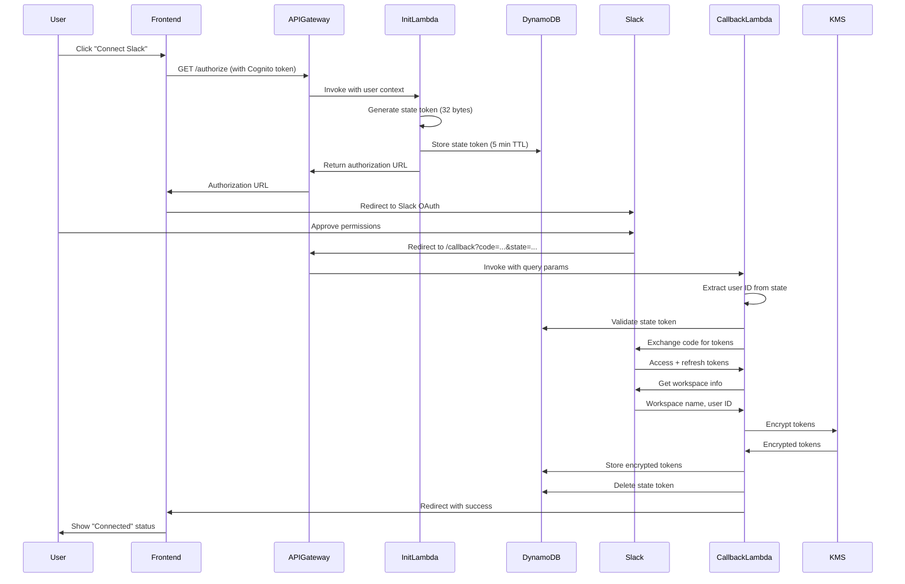

# Slack Integration Design Document

## Overview

The Slack Integration feature enables users to connect their Slack workspace to FlowRecall through an OAuth 2.0 flow, allowing the system to access and analyze Slack messages, threads, and channels. This design follows the established architectural pattern from the Gmail integration, leveraging AWS serverless infrastructure with Lambda functions, DynamoDB for storage, KMS for encryption, and API Gateway for HTTP endpoints.

The integration provides a secure, user-friendly experience for connecting Slack workspaces, managing connection status, and disconnecting when needed. All OAuth tokens are encrypted at rest using AWS KMS, and the system implements comprehensive error handling, logging, and retry mechanisms for reliability.

### Key Design Principles

- **Security First**: All OAuth tokens encrypted at rest with KMS, CSRF protection via state tokens, secure credential management via Parameter Store
- **Consistency**: Follows the same architectural patterns as Gmail integration for maintainability
- **User Experience**: Clear UI feedback, graceful error handling, automatic token refresh
- **Observability**: Structured logging throughout the OAuth flow without exposing sensitive data
- **Infrastructure as Code**: Complete CDK definition for reproducible deployments

## Architecture

### High-Level Architecture

The Slack integration follows an event-driven, serverless architecture:

```
┌─────────────┐
│   Frontend  │
│  (React UI) │
└──────┬──────┘
       │
       │ HTTPS (Cognito Auth)
       │
┌──────▼──────────────────────────────────────────┐
│         API Gateway (REST API)                   │
│  - Cognito Authorizer                            │
│  - Rate Limiting (10 req/s, burst 20)           │
│  - CORS Configuration                            │
└──────┬──────────────────────────────────────────┘
       │
       │ Invokes
       │
┌──────▼──────────────────────────────────────────┐
│           Lambda Functions                       │
│  ┌────────────────────────────────────────┐    │
│  │ 1. OAuth Initiation Handler            │    │
│  │    - Generate state token              │    │
│  │    - Build authorization URL           │    │
│  └────────────────────────────────────────┘    │
│  ┌────────────────────────────────────────┐    │
│  │ 2. OAuth Callback Handler              │    │
│  │    - Validate state token              │    │
│  │    - Exchange code for tokens          │    │
│  │    - Encrypt and store tokens          │    │
│  └────────────────────────────────────────┘    │
│  ┌────────────────────────────────────────┐    │
│  │ 3. Status Handler                      │    │
│  │    - Retrieve integration status       │    │
│  └────────────────────────────────────────┘    │
│  ┌────────────────────────────────────────┐    │
│  │ 4. Disconnect Handler                  │    │
│  │    - Revoke tokens with Slack          │    │
│  │    - Remove from database              │    │
│  └────────────────────────────────────────┘    │
└──────┬──────────────────────────────────────────┘
       │
       │ Read/Write
       │
┌──────▼──────────────────────────────────────────┐
│         DynamoDB Users Table                     │
│  - Partition Key: internalUserId                 │
│  - GSI: cognitoUserIdIndex                       │
│  - Stores: slackIntegration, oauthStateTokens   │
└──────┬──────────────────────────────────────────┘
       │
       │ Encrypt/Decrypt
       │
┌──────▼──────────────────────────────────────────┐
│         AWS KMS (Shared Key)                     │
│  - AES-256-GCM encryption                        │
│  - Automatic annual rotation                     │
│  - Shared with Gmail integration                 │
└──────────────────────────────────────────────────┘

┌──────────────────────────────────────────────────┐
│    AWS Systems Manager Parameter Store          │
│  - /flowrecall/slack-oauth-client-id            │
│  - /flowrecall/slack-oauth-client-secret        │
└──────────────────────────────────────────────────┘

┌──────────────────────────────────────────────────┐
│         Slack OAuth API                          │
│  - Authorization endpoint                        │
│  - Token exchange endpoint                       │
│  - Token revocation endpoint                     │
│  - Workspace/user info endpoints                 │
└──────────────────────────────────────────────────┘
```

### OAuth Flow Sequence



### Component Interaction

The system is organized into four main Lambda handlers that interact with shared infrastructure:

1. **OAuth Initiation Handler**: Entry point for OAuth flow, generates secure state tokens
2. **OAuth Callback Handler**: Processes Slack's redirect, exchanges codes for tokens
3. **Status Handler**: Retrieves current integration status for UI display
4. **Disconnect Handler**: Revokes tokens and removes integration

All handlers share:
- **DynamoDB Helper**: Abstracts GSI queries and updates
- **Token Manager**: Handles KMS encryption/decryption and token lifecycle
- **Logger**: Provides structured logging without exposing sensitive data

## Components and Interfaces

### Lambda Functions

#### 1. OAuth Initiation Handler

**Purpose**: Initiate the Slack OAuth flow by generating a secure state token and returning the Slack authorization URL.

**Endpoint**: `GET /api/integrations/slack/authorize`

**Authentication**: Cognito User Pools Authorizer

**Input**:
- Cognito user ID from authorizer context (`event.requestContext.authorizer.claims.sub`)
- API Gateway context for redirect URI construction

**Output**:
```typescript
{
  authorizationUrl: string  // Complete Slack OAuth URL with state token
}
```

**Error Responses**:
- `401 Unauthorized`: Missing or invalid Cognito session
- `500 Service Unavailable`: Missing OAuth credentials in Parameter Store

**Key Operations**:
1. Extract Cognito user ID from authorizer context
2. Fetch Slack client ID from Parameter Store (cached)
3. Generate cryptographically secure state token (32 bytes) with encoded user ID
4. Store state token in DynamoDB with 5-minute expiration
5. Construct redirect URI from API Gateway context
6. Build Slack authorization URL with required scopes
7. Return authorization URL to frontend

#### 2. OAuth Callback Handler

**Purpose**: Process Slack's OAuth redirect, validate state, exchange authorization code for tokens, and store encrypted tokens.

**Endpoint**: `GET /api/integrations/slack/callback`

**Authentication**: None (public endpoint with state token validation)

**Input**:
- Query parameters: `code`, `state`, `error` (optional)
- API Gateway context for redirect URI construction

**Output**: HTTP 302 redirect to frontend with status parameters

**Redirect Formats**:
- Success: `{FRONTEND_URL}/integrations?slack=connected`
- Cancelled: `{FRONTEND_URL}/integrations?slack=error&error=cancelled`
- Invalid state: `{FRONTEND_URL}/integrations?slack=error&error=invalid_state`
- Token exchange failed: `{FRONTEND_URL}/integrations?slack=error&error=token_exchange_failed`

**Key Operations**:
1. Extract code, state, and error from query parameters
2. Handle user cancellation (error=access_denied)
3. Parse state token to extract user ID
4. Validate state token exists in DynamoDB and not expired
5. Fetch Slack OAuth credentials from Parameter Store
6. Exchange authorization code for access and refresh tokens
7. Retrieve workspace name and user's Slack identity
8. Encrypt tokens using KMS via Token Manager
9. Store encrypted tokens with workspace info in DynamoDB
10. Delete used state token
11. Redirect to frontend with success/error status

#### 3. Status Handler

**Purpose**: Retrieve the current Slack integration status for the authenticated user.

**Endpoint**: `GET /api/integrations/slack/status`

**Authentication**: Cognito User Pools Authorizer

**Input**:
- Cognito user ID from authorizer context

**Output**:
```typescript
{
  status: 'connected' | 'disconnected' | 'error',
  workspaceName?: string,
  connectedAt?: string,  // ISO 8601 timestamp
  errorMessage?: string
}
```

**Key Operations**:
1. Extract Cognito user ID from authorizer context
2. Query DynamoDB for user record via GSI
3. Check for slackIntegration attribute
4. Return status with workspace info if connected

#### 4. Disconnect Handler

**Purpose**: Disconnect the Slack integration by revoking tokens and removing from database.

**Endpoint**: `POST /api/integrations/slack/disconnect`

**Authentication**: Cognito User Pools Authorizer

**Input**:
- Cognito user ID from authorizer context

**Output**:
```typescript
{
  success: boolean,
  message: string
}
```

**Error Responses**:
- `401 Unauthorized`: Missing or invalid Cognito session
- `404 Not Found`: No Slack integration found for user
- `500 Internal Server Error`: Failed to disconnect

**Key Operations**:
1. Extract Cognito user ID from authorizer context
2. Retrieve encrypted tokens from DynamoDB
3. Decrypt access token using KMS
4. Revoke token with Slack API (auth.revoke)
5. Remove slackIntegration attribute from DynamoDB
6. Return success response

### Shared Components

#### Token Manager

**Purpose**: Centralized component for OAuth token encryption, storage, retrieval, and deletion using AWS KMS.

**Key Methods**:

```typescript
class TokenManager {
  // Encrypt a token using KMS
  async encryptToken(token: string): Promise<string>
  
  // Decrypt a token using KMS
  async decryptToken(encryptedToken: string): Promise<string>
  
  // Store encrypted tokens in DynamoDB
  async storeTokens(
    userId: string,
    accessToken: string,
    refreshToken: string,
    expiresIn: number,
    workspaceName: string,
    workspaceId: string,
    slackUserId: string
  ): Promise<void>
  
  // Delete tokens and revoke with Slack
  async deleteTokens(userId: string): Promise<void>
}
```

**Features**:
- Retry logic with exponential backoff for transient failures
- Structured logging without exposing sensitive data
- Shared KMS key with Gmail integration
- Graceful handling of revocation failures

#### DynamoDB Helper

**Purpose**: Abstract DynamoDB operations using the cognitoUserIdIndex GSI since the table's partition key is internalUserId.

**Key Functions**:

```typescript
// Query user by Cognito ID using GSI
async function getUserByCognitoId(
  dynamoClient: DynamoDBDocumentClient,
  cognitoUserId: string
): Promise<Record<string, any> | null>

// Update user by Cognito ID (queries for internalUserId first)
async function updateUserByCognitoId(
  dynamoClient: DynamoDBDocumentClient,
  cognitoUserId: string,
  updateExpression: string,
  expressionAttributeNames?: Record<string, string>,
  expressionAttributeValues?: Record<string, any>
): Promise<void>
```

#### Logger

**Purpose**: Provide structured logging with consistent field names and security-conscious output.

**Key Features**:
- Structured JSON logging for CloudWatch
- Consistent field names (requestId, userId, operation)
- Never logs sensitive data (tokens, authorization codes, encryption keys)
- Only logs last 4 characters of tokens for debugging
- Specialized log methods for OAuth events

**Key Methods**:

```typescript
class Logger {
  info(message: string, metadata?: object): void
  warn(message: string, metadata?: object): void
  error(message: string, metadata?: object): void
  debug(message: string, metadata?: object): void
  
  // Specialized OAuth logging
  logOAuthInitiation(userId: string, success: boolean, error?: Error): void
  logOAuthCallback(userId: string, success: boolean, error?: Error): void
  logOAuthCancelled(): void
  logInvalidState(stateToken: string, userId?: string): void
  logExpiredState(stateToken: string, userId: string): void
  logTokenStore(userId: string, success: boolean, error?: Error): void
  logTokenDelete(userId: string, success: boolean, error?: Error): void
  logSlackAPIError(operation: string, error: Error): void
}
```

### Frontend Integration Card

**Purpose**: React component for displaying Slack connection status and managing the integration.

**States**:
- **Disconnected**: Shows "Connect" button
- **Connecting**: Shows loading spinner
- **Connected**: Shows workspace name, connection time, and "Disconnect" button
- **Error**: Shows error message and "Retry Connection" button

**Key Features**:
- Fetches status on mount
- Handles OAuth initiation by redirecting to authorization URL
- Processes OAuth callback query parameters
- Displays toast notifications for success/error
- Formats timestamps as relative time (e.g., "2 hours ago")

## Data Models

### DynamoDB User Record Schema

The Users table uses `internalUserId` as the partition key with a GSI on `cognitoUserId` for efficient lookups.

**Slack Integration Attribute**:

```typescript
interface SlackIntegration {
  encryptedAccessToken: string;      // Base64-encoded KMS-encrypted token
  encryptedRefreshToken: string;     // Base64-encoded KMS-encrypted token
  workspaceName: string;              // Human-readable workspace name
  workspaceId: string;                // Slack workspace ID (e.g., T1234567890)
  userId: string;                     // Slack user ID (e.g., U1234567890)
  connectedAt: string;                // ISO 8601 timestamp
  expiresAt: number;                  // Unix timestamp (milliseconds)
}
```

**OAuth State Tokens Attribute**:

```typescript
interface OAuthStateTokens {
  [stateToken: string]: {
    createdAt: number;    // Unix timestamp (milliseconds)
    expiresAt: number;    // Unix timestamp (milliseconds)
  }
}
```

**Complete User Record Structure** (relevant attributes):

```typescript
interface UserRecord {
  internalUserId: string;              // Partition key
  cognitoUserId: string;               // GSI key
  email: string;
  created: string;                     // ISO 8601 timestamp
  updated: string;                     // ISO 8601 timestamp
  slackIntegration?: SlackIntegration; // Present when connected
  oauthStateTokens?: OAuthStateTokens; // Temporary state tokens
  // ... other attributes
}
```

### Slack OAuth Scopes

The integration requests the following OAuth scopes:

| Scope | Purpose |
|-------|---------|
| `channels:history` | Read messages from public channels |
| `groups:history` | Read messages from private channels user has access to |
| `im:history` | Read direct messages |
| `mpim:history` | Read multi-party direct messages |
| `users:read` | Identify the connected user |
| `team:read` | Identify the workspace |
| `channels:read` | List available public channels |
| `groups:read` | List available private channels |

### Slack API Endpoints

**OAuth Authorization**:
```
GET https://slack.com/oauth/v2/authorize
  ?client_id={clientId}
  &redirect_uri={redirectUri}
  &scope={scopes}
  &state={stateToken}
```

**Token Exchange**:
```
POST https://slack.com/api/oauth.v2.access
Content-Type: application/x-www-form-urlencoded

client_id={clientId}
&client_secret={clientSecret}
&code={authorizationCode}
&redirect_uri={redirectUri}
```

**Response**:
```typescript
interface SlackTokenResponse {
  ok: boolean;
  access_token: string;
  token_type: string;
  scope: string;
  bot_user_id?: string;
  app_id: string;
  team: {
    name: string;
    id: string;
  };
  enterprise?: {
    name: string;
    id: string;
  };
  authed_user: {
    id: string;
    scope: string;
    access_token: string;
    token_type: string;
  };
  error?: string;
}
```

**Token Revocation**:
```
POST https://slack.com/api/auth.revoke
Authorization: Bearer {accessToken}
```

**Workspace Info**:
```
GET https://slack.com/api/team.info
Authorization: Bearer {accessToken}
```

**User Info**:
```
GET https://slack.com/api/users.info?user={userId}
Authorization: Bearer {accessToken}
```

### API Gateway Configuration

**Endpoints**:

| Method | Path | Auth | Timeout | Purpose |
|--------|------|------|---------|---------|
| GET | `/api/integrations/slack/authorize` | Cognito | 10s | Initiate OAuth flow |
| GET | `/api/integrations/slack/callback` | None | 30s | Process OAuth redirect |
| GET | `/api/integrations/slack/status` | Cognito | 10s | Get integration status |
| POST | `/api/integrations/slack/disconnect` | Cognito | 30s | Disconnect integration |

**Rate Limiting**:
- Rate limit: 10 requests/second per user
- Burst limit: 20 requests
- Daily quota: 1000 requests per user

**CORS Configuration**:
- Allowed origins: `http://localhost:5173`, `https://app.flowrecall.com`
- Allowed methods: `GET`, `POST`, `OPTIONS`
- Allowed headers: `Content-Type`, `Authorization`
- Credentials: Enabled

### State Token Format

State tokens encode the user ID for efficient lookup without table scans:

**Format**: `base64url(cognitoUserId):randomToken`

**Example**: `dXNlci0xMjM0NTY3ODkw:a1b2c3d4e5f6g7h8i9j0k1l2m3n4o5p6q7r8s9t0u1v2w3x4y5z6`

**Properties**:
- 32 bytes of cryptographic randomness
- User ID encoded for O(1) lookup
- 5-minute expiration
- Single-use (deleted after validation)

### Error Codes

| Code | Description | Retryable | User Message |
|------|-------------|-----------|--------------|
| `service_unavailable` | OAuth credentials missing from Parameter Store | Yes | "Service temporarily unavailable, please try again" |
| `invalid_state` | State token invalid, expired, or missing | No | "Invalid or expired authorization, please try again" |
| `token_exchange_failed` | Failed to exchange code for tokens with Slack | Yes | "Failed to connect Slack workspace, please try again" |
| `storage_failed` | Failed to store tokens in DynamoDB | Yes | "Failed to save connection, please try again" |
| `cancelled` | User cancelled OAuth flow | No | "Connection cancelled" |
| `unauthorized` | Missing or invalid Cognito session | No | "Please sign in and try again" |
| `not_found` | No integration found for disconnect | No | "No Slack connection found" |


## Correctness Properties

*A property is a characteristic or behavior that should hold true across all valid executions of a system—essentially, a formal statement about what the system should do. Properties serve as the bridge between human-readable specifications and machine-verifiable correctness guarantees.*

### Property 1: State Token Entropy

*For any* OAuth initiation request, the generated state token SHALL contain at least 32 bytes of cryptographic entropy from a secure random source.

**Validates: Requirements 1.2**

### Property 2: State Token Round-Trip

*For any* Cognito user ID, encoding it into a state token and then extracting it from that token SHALL return the original user ID unchanged.

**Validates: Requirements 1.3, 3.1**

### Property 3: State Token Storage with Expiration

*For any* state token created during OAuth initiation, the token SHALL be stored in DynamoDB with an expiration time exactly 5 minutes (300 seconds) from creation.

**Validates: Requirements 1.4**

### Property 4: Authorization URL Completeness

*For any* generated Slack authorization URL, parsing the URL SHALL reveal the presence of all required components: state token, client ID, redirect URI, and all 8 required OAuth scopes.

**Validates: Requirements 1.5, 9.1, 9.2, 9.3, 9.4, 9.5, 9.6, 9.7, 9.8**

### Property 5: Parameter Store Caching

*For any* Lambda execution context, multiple requests for OAuth credentials SHALL result in only one Parameter Store API call, with subsequent requests served from cache.

**Validates: Requirements 2.3**

### Property 6: State Token Validation

*For any* state token, validation SHALL check both existence in the user record AND that the current time is before the expiration time, returning false if either condition fails.

**Validates: Requirements 3.2**

### Property 7: Token Encryption Round-Trip

*For any* OAuth token string, encrypting it with KMS and then decrypting the result SHALL return the original token unchanged.

**Validates: Requirements 3.7, 5.1, 5.2, 7.3**

### Property 8: Token Storage Completeness

*For any* successful token storage operation, the stored slackIntegration record SHALL contain all required fields: encryptedAccessToken, encryptedRefreshToken, workspaceName, workspaceId, userId, connectedAt (ISO 8601 format), and expiresAt (calculated from expires_in).

**Validates: Requirements 3.8, 5.3, 5.4, 5.5**

### Property 9: State Token Cleanup

*For any* successful OAuth callback flow, the state token used in that flow SHALL be removed from the user's oauthStateTokens map in DynamoDB.

**Validates: Requirements 3.9**

### Property 10: Cancellation Invariant

*For any* OAuth flow that is cancelled by the user (access_denied), the user's slackIntegration attribute SHALL remain unchanged from its state before the OAuth flow began.

**Validates: Requirements 4.3**

### Property 11: Token Expiration Calculation

*For any* token response from Slack with an expires_in value of N seconds, the stored expiresAt timestamp SHALL equal the current time plus N seconds (within a 1-second tolerance for processing time).

**Validates: Requirements 5.5**

### Property 12: Status Determination

*For any* user record, the integration status SHALL be "connected" if and only if the slackIntegration attribute exists with valid encryptedAccessToken and encryptedRefreshToken fields; otherwise it SHALL be "disconnected" or "error".

**Validates: Requirements 6.3, 6.4**

### Property 13: Disconnect Cleanup

*For any* successful disconnect operation, the user record SHALL have the slackIntegration attribute completely removed, regardless of whether token revocation with Slack succeeded or failed.

**Validates: Requirements 7.6, 13.10**

### Property 14: Error Message Mapping

*For any* error code returned by the backend (service_unavailable, invalid_state, token_exchange_failed, storage_failed, cancelled, unauthorized, not_found), the frontend SHALL display a corresponding user-friendly error message.

**Validates: Requirements 11.6**

### Property 15: Redirect URI Consistency

*For any* API Gateway event context, constructing the redirect URI in the OAuth Initiation Handler and constructing it in the OAuth Callback Handler SHALL produce identical URIs.

**Validates: Requirements 14.3, 14.5**

### Property 16: Redirect URI Format

*For any* API Gateway event context with apiId, stage, and region, the constructed redirect URI SHALL match the format `https://{apiId}.execute-api.{region}.amazonaws.com/{stage}/api/integrations/slack/callback`.

**Validates: Requirements 14.1, 14.2, 14.3, 14.4**

### Property 17: Timestamp Formatting

*For any* ISO 8601 timestamp, the Integration Card's formatting function SHALL produce a relative time string (e.g., "2 hours ago", "3 days ago") that accurately reflects the time difference.

**Validates: Requirements 10.9**

### Property 18: Structured Logging Format

*For any* log entry produced by the Slack Integration System, the log SHALL be valid JSON with consistent field names (requestId, userId, operation, timestamp) and SHALL NOT contain sensitive data (tokens, authorization codes, encryption keys, or more than the last 4 characters of any credential).

**Validates: Requirements 15.9, 15.10**

### Property 19: Logging Coverage

*For any* OAuth flow operation (initiation, callback, state validation, token exchange, token storage, disconnect, KMS operations), the system SHALL produce at least one log entry with the operation type and outcome (success/failure).

**Validates: Requirements 15.1, 15.2, 15.3, 15.4, 15.5, 15.6, 15.7, 15.8**

### Property 20: Schema Validation

*For any* user record with a connected Slack integration, the slackIntegration attribute SHALL be a Map containing exactly these fields with correct types: encryptedAccessToken (String), encryptedRefreshToken (String), workspaceName (String), workspaceId (String), userId (String), connectedAt (String in ISO 8601 format), expiresAt (Number).

**Validates: Requirements 13.1, 13.2, 13.3, 13.4, 13.5, 13.6, 13.7, 13.8**

## Error Handling

### Error Categories

The Slack integration implements comprehensive error handling across four categories:

1. **User Errors**: Invalid input, cancelled flows, expired sessions
2. **Integration Errors**: Slack API failures, token exchange failures
3. **System Errors**: DynamoDB failures, KMS failures, Parameter Store unavailability
4. **Network Errors**: Timeouts, connection failures

### Error Handling Strategy

#### OAuth Initiation Handler

**Missing Cognito User ID**:
- Return 401 Unauthorized with clear message
- Log authentication failure
- Frontend displays "Please sign in and try again"

**Missing OAuth Credentials**:
- Return 500 Service Unavailable with retryable flag
- Log Parameter Store error
- Frontend displays "Service temporarily unavailable, please try again"

**DynamoDB Failures**:
- Retry with exponential backoff (3 attempts)
- Return 500 Internal Server Error if all retries fail
- Log detailed error for debugging

#### OAuth Callback Handler

**User Cancellation** (error=access_denied):
- Redirect to frontend with cancelled status
- No error logging (expected user action)
- Frontend displays "Connection cancelled"

**Invalid/Expired State Token**:
- Redirect to frontend with invalid_state error
- Log state validation failure with token details (not full token)
- Frontend displays "Invalid or expired authorization, please try again"

**Token Exchange Failure**:
- Log Slack API error response
- Redirect to frontend with token_exchange_failed error
- Frontend displays "Failed to connect Slack workspace, please try again"

**KMS Encryption Failure**:
- Retry with exponential backoff (3 attempts)
- Log KMS error with key ID
- Redirect to frontend with storage_failed error if all retries fail

**DynamoDB Storage Failure**:
- Retry with exponential backoff (3 attempts)
- Log storage error
- Redirect to frontend with storage_failed error if all retries fail

#### Status Handler

**Missing User Record**:
- Return disconnected status (not an error)
- User may not have signed up yet

**Corrupted Integration Data**:
- Return error status with descriptive message
- Log data corruption details
- Frontend displays error with "Retry Connection" button

#### Disconnect Handler

**Token Revocation Failure**:
- Log warning but continue with local cleanup
- Token may already be revoked or expired
- Still remove integration from DynamoDB
- Return success to user

**Missing Integration**:
- Return 404 Not Found
- Frontend displays "No Slack connection found"

**KMS Decryption Failure**:
- Log error but continue with cleanup
- Remove integration data even if decryption fails
- Return success to user (best effort cleanup)

### Retry Configuration

All retry operations use exponential backoff with jitter:

```typescript
const RETRY_CONFIG = {
  initialDelayMs: 100,
  multiplier: 2,
  maxDelayMs: 1000,
  jitterPercent: 25,
  maxAttempts: 3,
};
```

**Jitter Calculation**: ±25% random variation to prevent thundering herd

**Retryable Operations**:
- KMS encrypt/decrypt
- DynamoDB read/write
- Parameter Store reads

**Non-Retryable Operations**:
- Slack API calls (handled by Slack's rate limiting)
- User input validation
- State token validation

### Frontend Error Handling

**Network Errors**:
- Catch fetch failures
- Display generic error message
- Suggest checking internet connection and retrying

**API Errors**:
- Parse error code from response
- Map to user-friendly message
- Display with appropriate severity (error/warning/info)

**Timeout Handling**:
- Set 30-second timeout for all API calls
- Display timeout message if exceeded
- Suggest retrying

**Error Display**:
- Toast notifications for transient errors (auto-dismiss after 5 seconds)
- Persistent error messages for critical failures
- Clear call-to-action buttons (Retry, Dismiss, Contact Support)

## Testing Strategy

### Dual Testing Approach

The Slack integration requires both unit tests and property-based tests for comprehensive coverage:

**Unit Tests**: Verify specific examples, edge cases, error conditions, and integration points
**Property Tests**: Verify universal properties across all inputs through randomization

### Unit Testing

Unit tests focus on:

**Specific Examples**:
- OAuth flow with valid credentials returns authorization URL
- Callback with access_denied redirects with cancelled status
- Status endpoint returns connected when integration exists
- Disconnect removes slackIntegration attribute

**Edge Cases**:
- State token exactly at expiration boundary
- Empty workspace name from Slack
- Missing refresh token in Slack response
- Already-revoked token during disconnect

**Error Conditions**:
- Missing OAuth credentials in Parameter Store (Req 2.4)
- Invalid state token format (Req 3.3)
- Token exchange failure from Slack (Req 3.5)
- KMS encryption failure (Req 11.4)
- Token revocation failure during disconnect (Req 7.5)

**Integration Points**:
- DynamoDB helper correctly queries by Cognito ID
- Token Manager encrypts and stores tokens
- Logger produces structured output
- API Gateway passes correct context to Lambda

**Infrastructure Validation**:
- CDK synthesizes without errors
- All required endpoints are created (Req 8.1-8.4)
- Rate limiting configured correctly (Req 8.5-8.7)
- CORS origins match requirements (Req 8.8)
- Timeouts set appropriately (Req 8.9-8.10)
- KMS key has rotation enabled (Req 5.6)
- KMS key has retention policy (Req 5.7)

**UI Component Tests**:
- Integration Card renders in each state (Req 10.1-10.6)
- Connect button triggers OAuth flow (Req 1.1, 1.6)
- Disconnect button triggers disconnect (Req 7.1)
- Success/error messages display and auto-dismiss (Req 10.7, 10.8)
- Error messages map correctly (Req 11.6, 11.7)

### Property-Based Testing

Property tests verify universal properties with randomized inputs (minimum 100 iterations per test):

**Testing Library**: Use `fast-check` for TypeScript/JavaScript property-based testing

**Property Test Configuration**:
```typescript
import fc from 'fast-check';

// Example property test structure
fc.assert(
  fc.property(
    fc.string(), // arbitrary input generator
    (input) => {
      // Test property holds for all inputs
      const result = functionUnderTest(input);
      return verifyProperty(result);
    }
  ),
  { numRuns: 100 } // Minimum 100 iterations
);
```

**Property Tests to Implement**:

1. **State Token Entropy** (Property 1)
   - Tag: `Feature: slack-integration, Property 1: State token entropy`
   - Generate 100 state tokens, verify each has 32+ bytes entropy
   - Validates: Req 1.2

2. **State Token Round-Trip** (Property 2)
   - Tag: `Feature: slack-integration, Property 2: State token round-trip`
   - Generate random Cognito user IDs, encode then decode
   - Validates: Req 1.3, 3.1

3. **State Token Expiration** (Property 3)
   - Tag: `Feature: slack-integration, Property 3: State token expiration`
   - Generate random timestamps, verify expiration is +300 seconds
   - Validates: Req 1.4

4. **Authorization URL Completeness** (Property 4)
   - Tag: `Feature: slack-integration, Property 4: Authorization URL completeness`
   - Generate random state tokens and client IDs, verify URL contains all components
   - Validates: Req 1.5, 9.1-9.8

5. **Token Encryption Round-Trip** (Property 7)
   - Tag: `Feature: slack-integration, Property 7: Token encryption round-trip`
   - Generate random token strings, encrypt then decrypt
   - Validates: Req 3.7, 5.1, 5.2, 7.3

6. **Token Storage Completeness** (Property 8)
   - Tag: `Feature: slack-integration, Property 8: Token storage completeness`
   - Generate random token data, verify all fields present after storage
   - Validates: Req 3.8, 5.3, 5.4, 5.5

7. **State Token Cleanup** (Property 9)
   - Tag: `Feature: slack-integration, Property 9: State token cleanup`
   - Generate random OAuth flows, verify state token removed after success
   - Validates: Req 3.9

8. **Cancellation Invariant** (Property 10)
   - Tag: `Feature: slack-integration, Property 10: Cancellation invariant`
   - Generate random user states, verify unchanged after cancellation
   - Validates: Req 4.3

9. **Token Expiration Calculation** (Property 11)
   - Tag: `Feature: slack-integration, Property 11: Token expiration calculation`
   - Generate random expires_in values, verify correct timestamp calculation
   - Validates: Req 5.5

10. **Status Determination** (Property 12)
    - Tag: `Feature: slack-integration, Property 12: Status determination`
    - Generate random user records, verify status matches integration data
    - Validates: Req 6.3, 6.4

11. **Disconnect Cleanup** (Property 13)
    - Tag: `Feature: slack-integration, Property 13: Disconnect cleanup`
    - Generate random disconnect scenarios, verify attribute removed
    - Validates: Req 7.6, 13.10

12. **Error Message Mapping** (Property 14)
    - Tag: `Feature: slack-integration, Property 14: Error message mapping`
    - Generate all error codes, verify each has user-friendly message
    - Validates: Req 11.6

13. **Redirect URI Consistency** (Property 15)
    - Tag: `Feature: slack-integration, Property 15: Redirect URI consistency`
    - Generate random API Gateway contexts, verify same URI from both handlers
    - Validates: Req 14.3, 14.5

14. **Redirect URI Format** (Property 16)
    - Tag: `Feature: slack-integration, Property 16: Redirect URI format`
    - Generate random API Gateway contexts, verify URI matches format
    - Validates: Req 14.1, 14.2, 14.3, 14.4

15. **Timestamp Formatting** (Property 17)
    - Tag: `Feature: slack-integration, Property 17: Timestamp formatting`
    - Generate random timestamps, verify relative time accuracy
    - Validates: Req 10.9

16. **Structured Logging Format** (Property 18)
    - Tag: `Feature: slack-integration, Property 18: Structured logging format`
    - Generate random log entries, verify JSON format and no sensitive data
    - Validates: Req 15.9, 15.10

17. **Logging Coverage** (Property 19)
    - Tag: `Feature: slack-integration, Property 19: Logging coverage`
    - Generate random operations, verify each produces log entry
    - Validates: Req 15.1-15.8

18. **Schema Validation** (Property 20)
    - Tag: `Feature: slack-integration, Property 20: Schema validation`
    - Generate random integration records, verify schema compliance
    - Validates: Req 13.1-13.8

### Test Organization

```
backend/
├── lambda/
│   └── slack-integration/
│       ├── __tests__/
│       │   ├── oauth-initiation-handler.test.ts
│       │   ├── oauth-callback-handler.test.ts
│       │   ├── status.test.ts
│       │   ├── disconnect.test.ts
│       │   ├── token-manager.test.ts
│       │   ├── dynamodb-helper.test.ts
│       │   └── logger.test.ts
│       └── __property-tests__/
│           ├── state-token.property.test.ts
│           ├── token-encryption.property.test.ts
│           ├── oauth-flow.property.test.ts
│           ├── logging.property.test.ts
│           └── schema.property.test.ts
├── lib/
│   └── __tests__/
│       └── slack-integration-stack.test.ts

frontend/
└── src/
    └── components/
        └── __tests__/
            └── SlackIntegrationCard.test.tsx
```

### Mocking Strategy

**AWS Services**:
- Mock DynamoDB with `aws-sdk-client-mock`
- Mock KMS with `aws-sdk-client-mock`
- Mock SSM Parameter Store with `aws-sdk-client-mock`

**External APIs**:
- Mock Slack OAuth endpoints with `nock` or `msw`
- Provide fixtures for token responses, workspace info, user info

**Lambda Context**:
- Mock API Gateway event context with test utilities
- Provide sample Cognito authorizer claims

### Coverage Goals

- Unit test coverage: >80% for all Lambda handlers
- Property test coverage: 100% of correctness properties
- Integration test coverage: All API endpoints with auth scenarios
- Infrastructure test coverage: All CDK constructs synthesize correctly

### Continuous Integration

Tests run on every commit:
1. Lint TypeScript code
2. Run unit tests
3. Run property tests (100 iterations each)
4. Check test coverage thresholds
5. Synthesize CDK stacks
6. Run infrastructure tests

